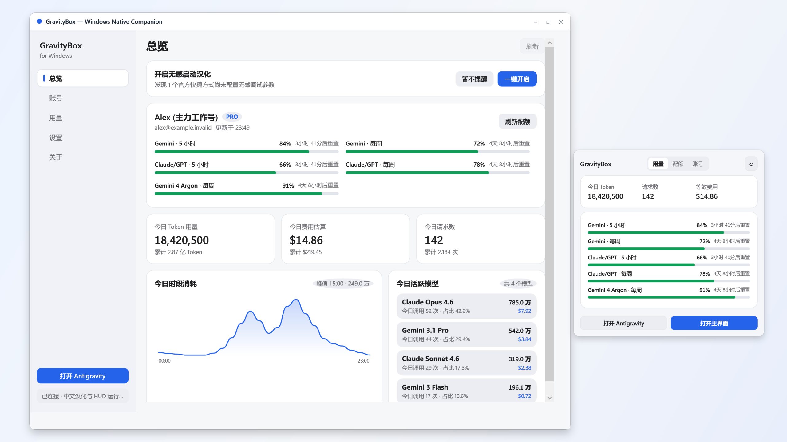
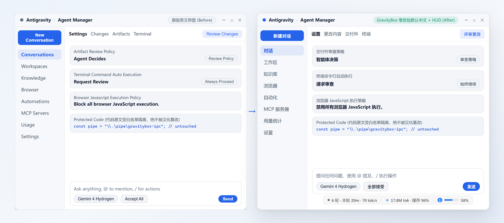
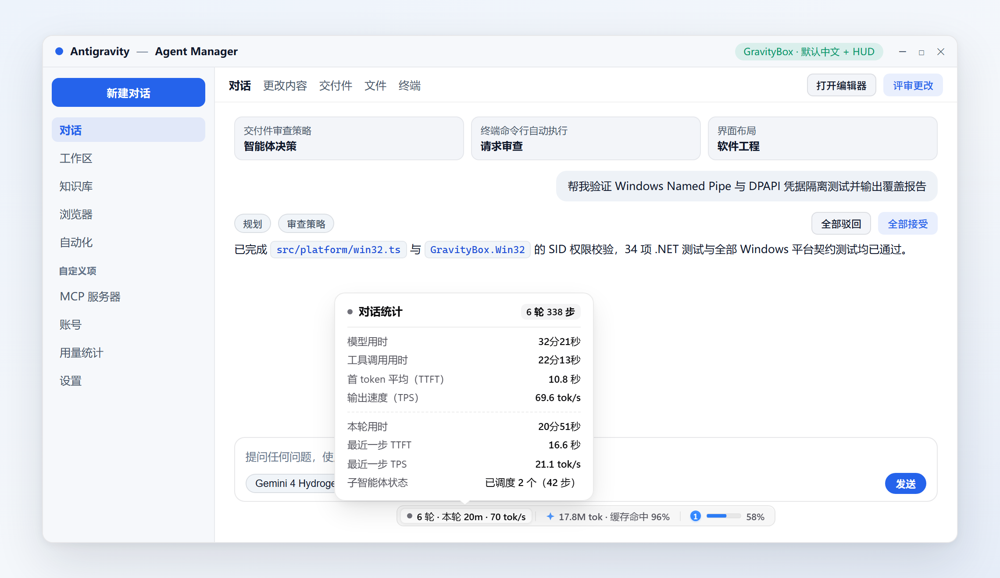
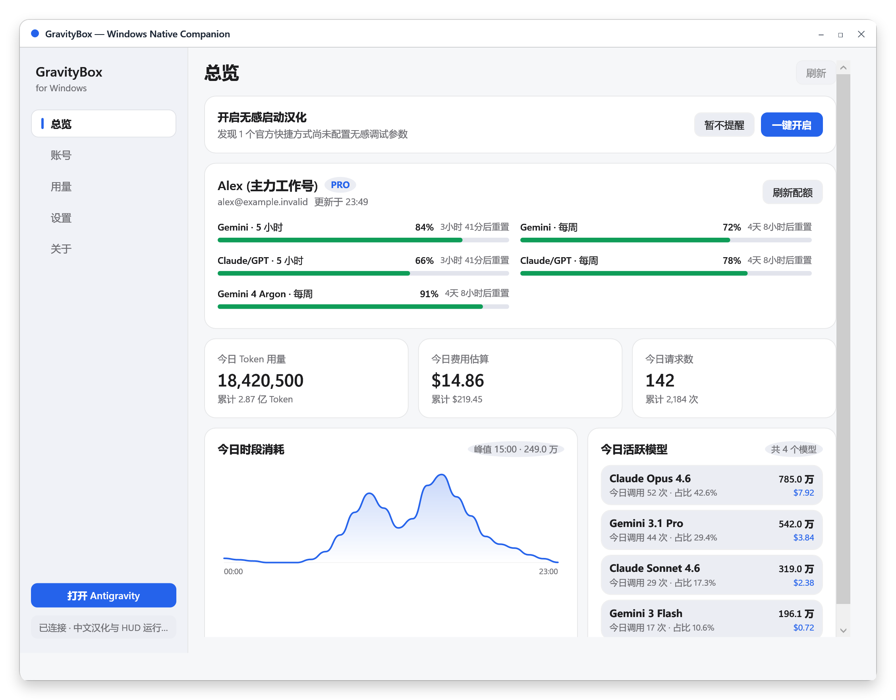
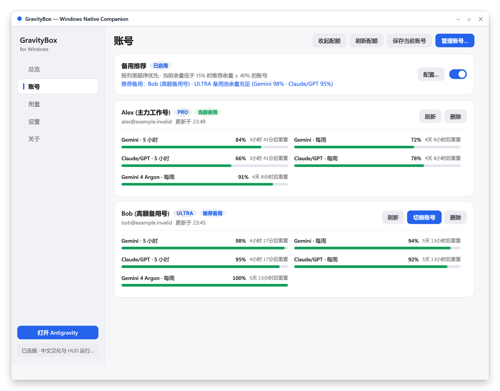
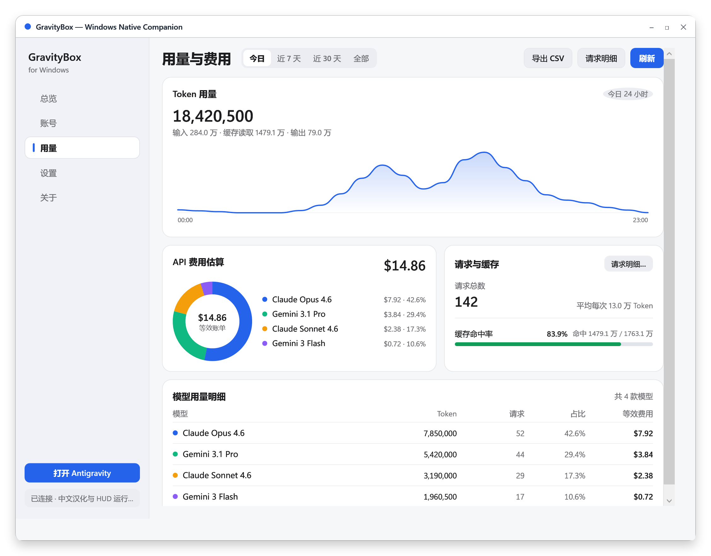
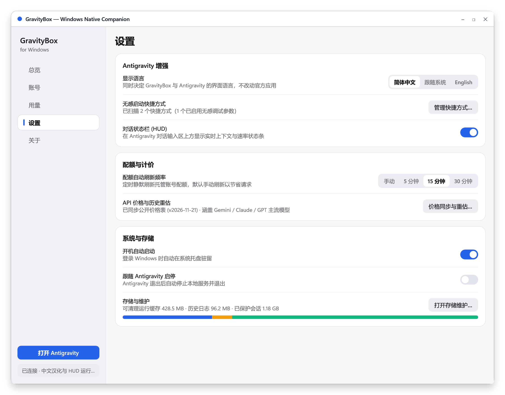
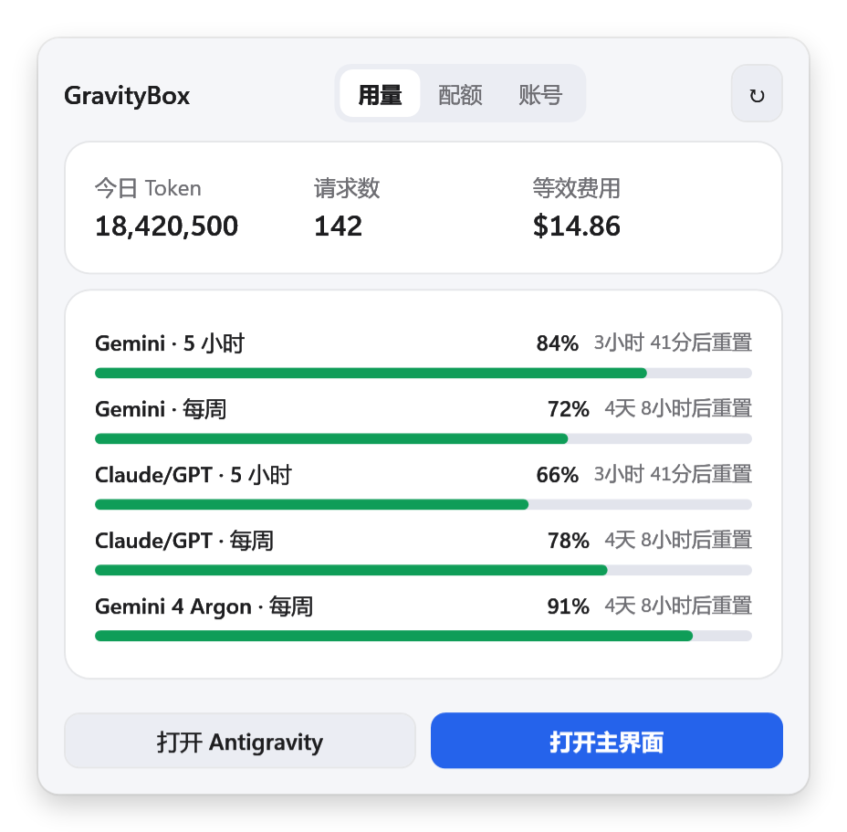
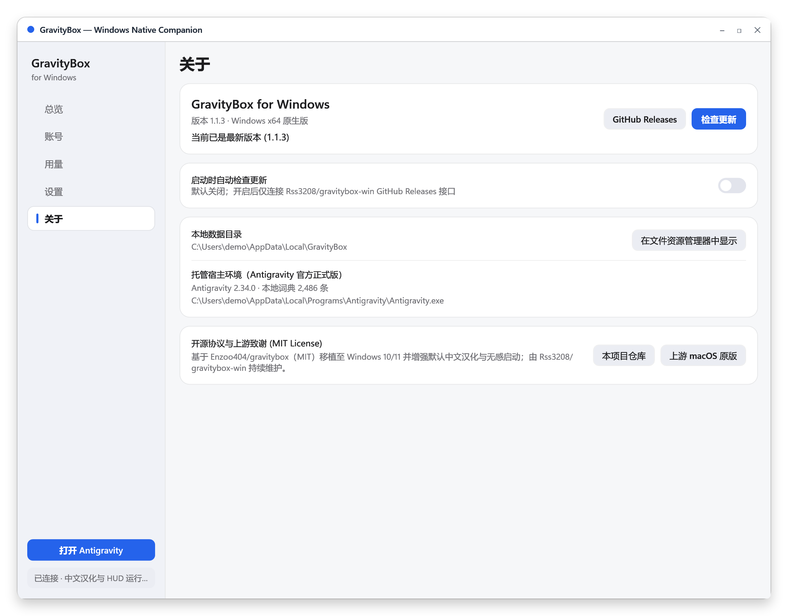
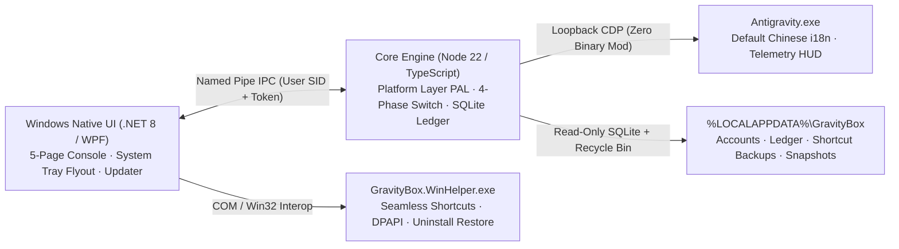

<div align="center">
  <a href="https://github.com/Rss3208/gravitybox-win">
    
  </a>

  <h1>GravityBox for Windows</h1>

  <p>
    <strong>Native Windows 10 / 11 Companion for Google Antigravity (Out-of-the-Box Chinese Localization)</strong><br />
    Default Simplified Chinese · Seamless Shortcut Launch · In-IDE Telemetry HUD · Dual-Window Quotas · Safe Account Switching · Reversible Cache Trim
  </p>

  <p>
    <a href="https://github.com/Rss3208/gravitybox-win/releases/latest"></a>
    <a href="https://github.com/Rss3208/gravitybox-win/actions/workflows/ci.yml"></a>
    
    
    <a href="./LICENSE"></a>
  </p>

  <p>
    <b>English</b> · <a href="./README.zh-CN.md">简体中文</a>
  </p>

  <p>
    <a href="#overview">Overview</a> ·
    <a href="#quick-start">Quick Start</a> ·
    <a href="#zero-patch-default-chinese-localization">Localization</a> ·
    <a href="#in-ide-telemetry-hud">Telemetry HUD</a> ·
    <a href="#windows-console-previews">Console Previews</a> ·
    <a href="#installation--verification">Installation</a> ·
    <a href="#security--privacy">Security</a> ·
    <a href="#architecture--build">Build</a> ·
    <a href="#upstream-attribution--license">Attribution &amp; License</a>
  </p>
</div>

<br />

> **Upstream Attribution**: This repository is a **native Windows 10 / 11 port and enhancement** of [`Enzoo404/gravitybox`](https://github.com/Enzoo404/gravitybox) (MIT License). It preserves the original MIT copyright notice and full upstream Git history while adding a native `.NET 8 WPF` desktop client, `GravityBox.Win32` / `WinHelper` integration, out-of-the-box Simplified Chinese localization, seamless `.lnk` shortcut management, and Windows DPAPI credential isolation. For macOS, please use the upstream repository [`Enzoo404/gravitybox`](https://github.com/Enzoo404/gravitybox).

<div align="center">
  <picture>
    <source media="(prefers-color-scheme: dark)" srcset="assets/screenshots/win/win-hero-dark.png" />
    
  </picture>
  <sub><em>.NET 8 / WPF Native Console and DPI-Aware System Tray Flyout (automatically follows Windows Light &amp; Dark themes)</em></sub>
</div>

---

## Overview

**GravityBox for Windows** (`GravityBox v1.1.4`) is a lightweight, native Windows 10 / 11 (`x64`) companion for the official stable release of `Antigravity.exe`. Release packages bundle self-contained `.NET 8` and `Node 22` runtimes with zero prerequisites and communicate strictly over loopback CDP, per-user Named Pipes, and read-only SQLite snapshots—**never unpacking, patching, or re-signing the official Antigravity binaries**.

| Capability | What It Solves |
| :--- | :--- |
| **Default Chinese Localization** | Launches out-of-the-box in Simplified Chinese (`zh-Hans`) with zero-patch dynamic IDE localization (`2.23.0`–`2.34.0+`) and instant runtime switching between **简体中文 / Follow System / English**. Prompts, chats, code blocks, and terminal logs remain strictly untouched. |
| **Seamless Shortcut Launch** | Includes `GravityBox.WinHelper.exe` and a guided `.lnk` shortcut manager to attach `--remote-debugging-port=0` to Desktop / Start Menu shortcuts (with automatic snapshot backup, one-click restore, and automatic restore on uninstall). |
| **In-IDE Telemetry HUD** | Mounts a compact 3-capsule toolbar beneath each Antigravity chat composer showing turn duration, TTFT / TPS, token totals, cache hit rate, compaction badge, and model context usage (with independent bilingual support). |
| **Dual-Window Quotas & Usage** | Separates **5-Hour** rolling limits from **Weekly** caps and standalone high-tier pools (e.g. `Gemini 4 Argon`), folds thinking variants (`-low` to `-max`) in summaries, tracks historical spend via dated official API rates, and exports CSV reports. |
| **Multi-Account & DPAPI Safety** | Supports one-click live account capture, batch JSON import/export, standby recommendations, non-invasive `agy` CLI token sync, atomic 4-phase switching with 7-day rollback, and Windows **DPAPI** credential encryption. |
| **Reversible Cache Trim** | Visualizes Runtime Cache, History Logs, and Protected Core Data; moves cleanable caches to the Windows Recycle Bin with one-click in-place restore while isolating credentials and chat databases behind an allowlist. |

---

## Quick Start

1. **Download & Install**: Get the latest Windows build from [GitHub Releases](https://github.com/Rss3208/gravitybox-win/releases/latest):
   - **Installer (Recommended)**: `GravityBox-1.1.4-win-x64-setup.exe` (per-user install, no UAC/Admin required; automatically restores shortcuts on uninstall).
   - **Portable ZIP**: `GravityBox-1.1.4-win-x64-portable.zip` (extract anywhere and launch `GravityBox.exe`).
   > **Windows SmartScreen Notice**: Community open-source binaries are not signed with a paid EV certificate. If SmartScreen shows *"Windows protected your PC"*, choose **More info → Run anyway** (you can also verify the `.sha256` checksum below or build directly from source).
2. **Launch & Connect (Chinese Ready by Default)**: Open **GravityBox**, optionally click **One-Click Enable** on the Overview card to enable seamless Antigravity shortcut launching, or launch directly via **Open Antigravity** in the sidebar. If Antigravity is already running without a debug port, click **Safe Relaunch to Connect** for a clean restart.
3. **Three Surfaces**: Monitor live sessions in the **In-IDE HUD**, click the **System Tray Flyout** (`Ctrl+1/2/3`) for quick quotas and account switching, or open the **WPF Main Console** (`Ctrl+1`–`5`) for detailed usage analytics, account policies, shortcuts, and storage maintenance.

---

## Zero-Patch Default Chinese Localization

GravityBox for Windows launches with **Simplified Chinese (`zh-Hans`) enabled by default** (switchable anytime to `English` or `Follow System` with zero restart). All translations run dynamically inside a local loopback CDP isolated world—**never modifying `Antigravity.exe` or `app.asar`**—while strict semantic guards keep code blocks, chat messages, prompts, and terminal output completely untouched:

<div align="center">
  <picture>
    <source media="(prefers-color-scheme: dark)" srcset="assets/screenshots/win/win-i18n-compare-dark.png" />
    
  </picture>
  <sub><em>Live engine comparison: Original English Antigravity UI (left) → Zero-patch Chinese localization + mounted Telemetry HUD (right), with code blocks strictly isolated</em></sub>
</div>

---

## In-IDE Telemetry HUD

The HUD mounts cleanly below every Antigravity composer without overlapping native controls or stealing focus. Hover or click any capsule to reveal **Session Stats**, **Token Usage**, and **Current Context** cards:

<div align="center">
  <picture>
    <source media="(prefers-color-scheme: dark)" srcset="assets/screenshots/win/win-i18n-hud-dark.png" />
    
  </picture>
  <sub><em>Localized Windows Antigravity workspace with the 3-capsule Telemetry HUD and expanded Session Stats popover (Model/Tool duration, TTFT, TPS, and subagent counts)</em></sub>
</div>

<br />

<div align="center">
  <picture>
    <source media="(prefers-color-scheme: dark)" srcset="assets/screenshots/en-hud-capsules-dark.png" />
    
  </picture>
</div>

| Segment | Readout & Indicators | Meaning |
| :--- | :--- | :--- |
| **1. Session & Speed** | `Gray` / `Solid Blue` / `Breathing Blue` dot + `3T · Turn 18s · 90 tok/s · 2` | Foreground activity indicator (**Gray** idle/background-only, **Solid Blue** streaming/thinking, **Breathing Blue** tool execution) plus turn count, elapsed time, average TPS, and active subagents. |
| **2. Tokens & Cache** | `58.6M tok · Cache Hit 97%` | Cumulative session + subagent token consumption and prompt cache hit share. |
| **3. Context Meter** | Badge (`1` / `2` / `3+`) + Model tag + Meter (`66%`) | Compaction counter badge, active model tag across multi-model/orchestrator runs, and context saturation bar. |

### Upward Detail Popovers

Hover or click any capsule to open detailed breakdown cards (`Esc` or click outside to dismiss):

<table>
  <tr>
    <td width="33.3%" align="center">
      <b>Session Stats</b><br /><br />
      <picture>
        <source media="(prefers-color-scheme: dark)" srcset="assets/screenshots/en-hud-card-session-dark.png" />
        
      </picture>
    </td>
    <td width="33.3%" align="center">
      <b>Token Usage</b><br /><br />
      <picture>
        <source media="(prefers-color-scheme: dark)" srcset="assets/screenshots/en-hud-card-tokens-dark.png" />
        
      </picture>
    </td>
    <td width="33.3%" align="center">
      <b>Current Context (v1.1.3)</b><br /><br />
      <picture>
        <source media="(prefers-color-scheme: dark)" srcset="assets/screenshots/en-hud-card-context-dark.png" />
        
      </picture>
    </td>
  </tr>
</table>

---

## Windows Console Previews

All Windows previews below are captured directly from the native `.NET 8 WPF` client at 2× DPI in Light & Dark themes using sanitized synthetic fixtures (`@example.invalid` / `C:\Users\demo\...`):

<table>
  <tr>
    <td width="50%" align="center">
      <b>Overview (Seamless Shortcut Guide · Dual Quotas · 24h Curve)</b><br /><br />
      <picture>
        <source media="(prefers-color-scheme: dark)" srcset="assets/screenshots/win/win-overview-dark.png" />
        
      </picture>
    </td>
    <td width="50%" align="center">
      <b>Accounts (Multi-Account Pool · Standby Advisor · Atomic Switch)</b><br /><br />
      <picture>
        <source media="(prefers-color-scheme: dark)" srcset="assets/screenshots/win/win-accounts-dark.png" />
        
      </picture>
    </td>
  </tr>
  <tr>
    <td width="50%" align="center">
      <b>Usage &amp; API Cost (Trend Chart · Donut · Cache Hit · CSV)</b><br /><br />
      <picture>
        <source media="(prefers-color-scheme: dark)" srcset="assets/screenshots/win/win-usage-dark.png" />
        
      </picture>
    </td>
    <td width="50%" align="center">
      <b>Settings (Default Chinese · Shortcut Manager · Storage Trim)</b><br /><br />
      <picture>
        <source media="(prefers-color-scheme: dark)" srcset="assets/screenshots/win/win-settings-dark.png" />
        
      </picture>
    </td>
  </tr>
</table>

<details>
<summary>More previews: System Tray Flyout &amp; About / Updater</summary>
<br />
<table>
  <tr>
    <td width="38%" align="center">
      <b>System Tray Flyout</b><br /><br />
      <picture>
        <source media="(prefers-color-scheme: dark)" srcset="assets/screenshots/win/win-tray-dark.png" />
        
      </picture>
    </td>
    <td width="62%" align="center">
      <b>About, Self-Updater &amp; MIT Attribution</b><br /><br />
      <picture>
        <source media="(prefers-color-scheme: dark)" srcset="assets/screenshots/win/win-about-dark.png" />
        
      </picture>
    </td>
  </tr>
</table>
</details>

---

## Installation & Verification

- **Requirements**: Windows 10 (1903+) or Windows 11 (`x64`) and official stable Antigravity (`%LOCALAPPDATA%\Programs\Antigravity\Antigravity.exe`). Release artifacts bundle self-contained `.NET 8` and `Node 22` runtimes—no external runtime installation is needed.
- **Verify SHA-256 Checksum in PowerShell**:
  ```powershell
  # Installer
  Get-FileHash .\GravityBox-1.1.4-win-x64-setup.exe -Algorithm SHA256
  Get-Content .\GravityBox-1.1.4-win-x64-setup.exe.sha256

  # Portable ZIP
  Get-FileHash .\GravityBox-1.1.4-win-x64-portable.zip -Algorithm SHA256
  Get-Content .\GravityBox-1.1.4-win-x64-portable.zip.sha256
  ```
- **Non-Destructive Upgrades & In-App Updates**: Accounts, usage ledgers, custom dictionary overrides, shortcut backups, and cleanup restore points reside in `%LOCALAPPDATA%\GravityBox`. In-app update checks default to Off and query [`Rss3208/gravitybox-win`](https://github.com/Rss3208/gravitybox-win/releases) with strict `.sha256` sidecar verification.
- **Clean Uninstall**: Uninstalling via Windows *Settings → Apps* automatically runs `GravityBox.WinHelper.exe --restore-shortcuts` to restore original Antigravity shortcuts. Optionally delete `%LOCALAPPDATA%\GravityBox` to wipe local state.

---

## Security & Privacy

| Guarantee | Windows Mechanism |
| :--- | :--- |
| **Zero Telemetry** | No analytics SDKs, crash reporting, or unprompted outbound requests. Update checks and remote pricing sync default to Off. |
| **Untouched Official Binaries** | Operates solely through local loopback (`127.0.0.1`) CDP isolated worlds; never modifies `Antigravity.exe` or `app.asar`. |
| **DPAPI & Per-User SID IPC** | Local credentials are protected with Windows **DPAPI (`DataProtectionScope.CurrentUser`)**; Named Pipe IPC enforces current-user SID ACLs and `ipc.token`. |
| **Protected Content & Recycle Bin** | Prompts, chats, code blocks, and terminal logs are excluded by DOM guards; storage cleanup moves files to the Recycle Bin with 7-day restore points. |

---

## Architecture & Build



### Build & Package on Windows

Requires **Node.js `>=22.15.0 <23`** and **.NET 8 SDK** (plus **Inno Setup 6** to compile `setup.exe`):

```powershell
git clone https://github.com/Rss3208/gravitybox-win.git
cd gravitybox-win
npm ci

npm run build                    # Build TypeScript backend & runtime scripts
npm run test:win                 # Run Windows backend unit & platform contract tests
npm run test:win-native          # Run .NET 8 WPF / Win32 xUnit test suite
npm run check:privacy            # Run privacy & local-path leak gate
node tools/check-docs.mjs --source-only
npm run package:win              # Build self-contained portable ZIP & setup.exe + .sha256
```

See [`docs/sdd/README.md`](./docs/sdd/README.md) and [`docs/sdd/acceptance-report-win.md`](./docs/sdd/acceptance-report-win.md) for the complete Windows Spec-Driven Development specifications and verification summary.

---

## Upstream Attribution & License

- **License**: Released under the [**MIT License**](./LICENSE), preserving upstream copyright (`Copyright (c) 2026 Enzoo404`) alongside Windows port copyright (`Copyright (c) 2026 Rss3208`).
- **Upstream Credit**: Huge thanks to [**Enzoo404/gravitybox**](https://github.com/Enzoo404/gravitybox) for designing the original zero-patch localization architecture, Telemetry HUD, dual-window quota model, and atomic multi-account engine. If you are on macOS, please support and use the upstream repository directly.
- **Third-Party Notices & Trademarks**: See [`THIRD_PARTY_NOTICES.md`](./THIRD_PARTY_NOTICES.md).
- **Contributing**: See [`CONTRIBUTING.md`](./CONTRIBUTING.md), [`CODE_OF_CONDUCT.md`](./CODE_OF_CONDUCT.md), [`SECURITY.md`](./SECURITY.md), and [`CHANGELOG.md`](./CHANGELOG.md). Feedback and bug reports are welcome via [GitHub Issues](https://github.com/Rss3208/gravitybox-win/issues).

<p align="center">
  <sub>Released under the <a href="./LICENSE">MIT License</a> · Ported from <a href="https://github.com/Enzoo404/gravitybox">Enzoo404/gravitybox</a> · Third-party notices in <a href="./THIRD_PARTY_NOTICES.md">THIRD_PARTY_NOTICES.md</a> · Not affiliated with or endorsed by Google, Antigravity, or Microsoft.</sub>
</p>
