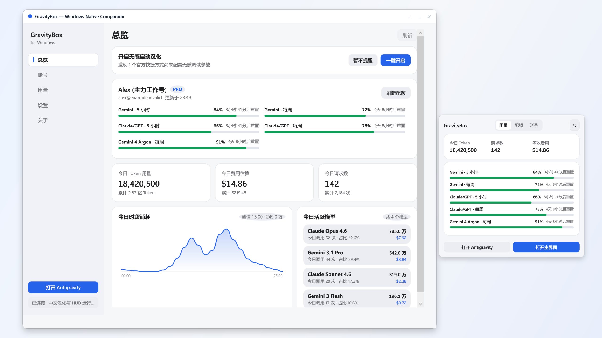
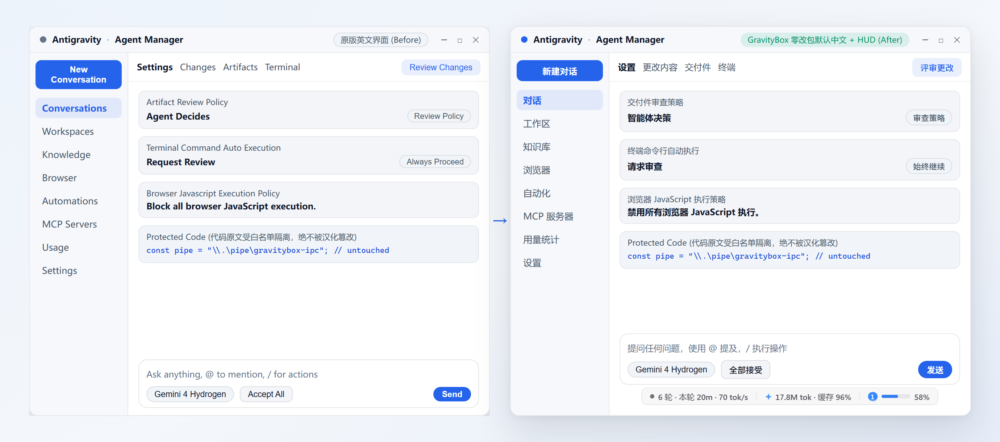
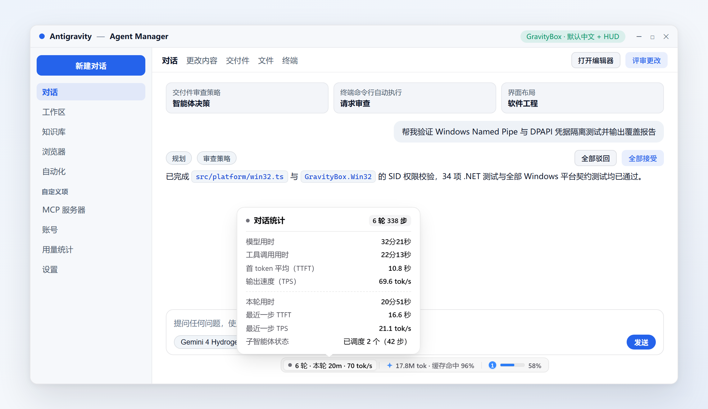
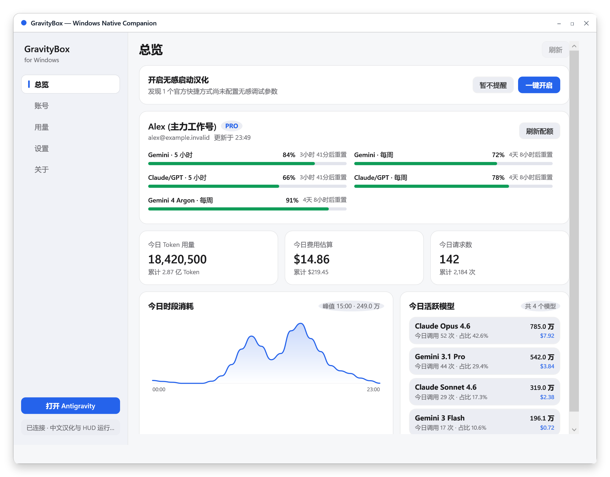
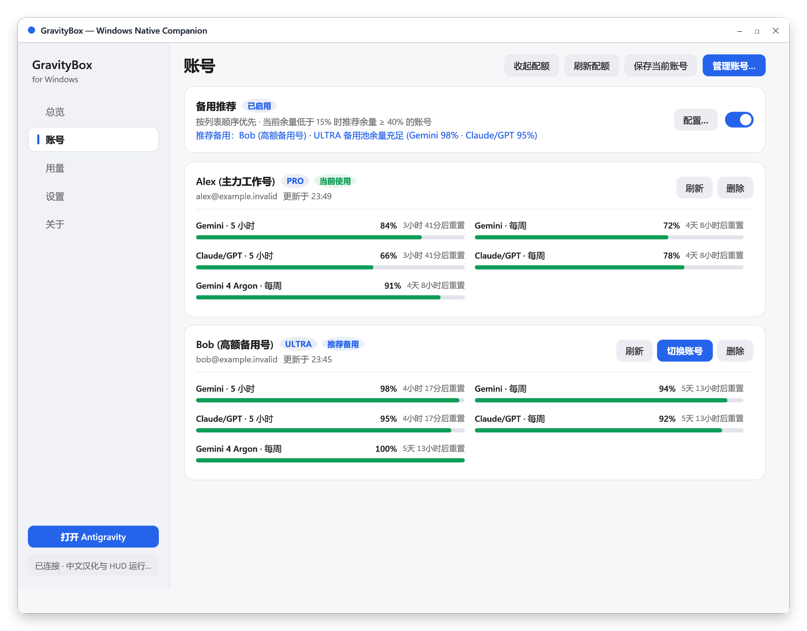
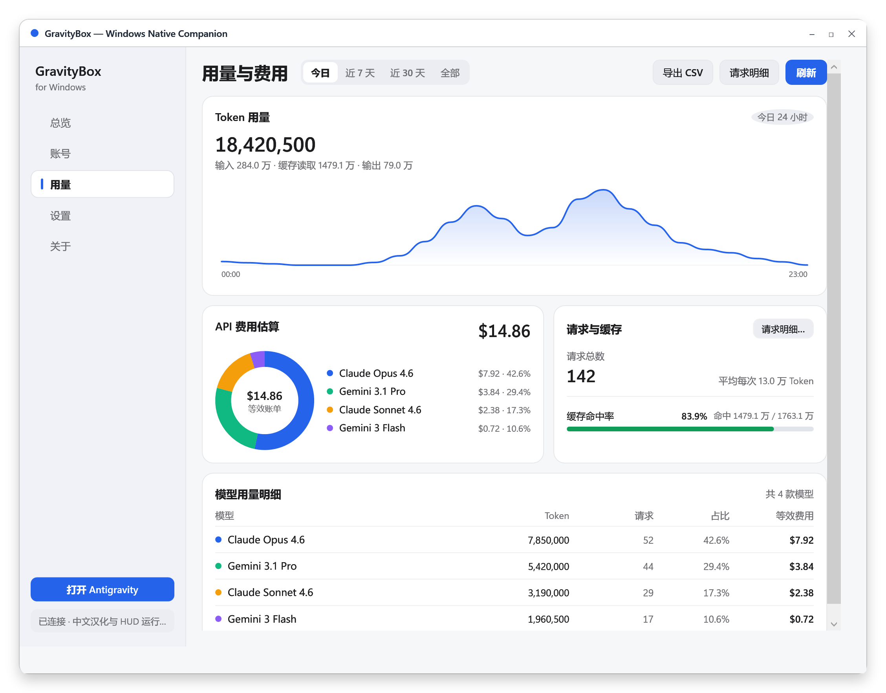
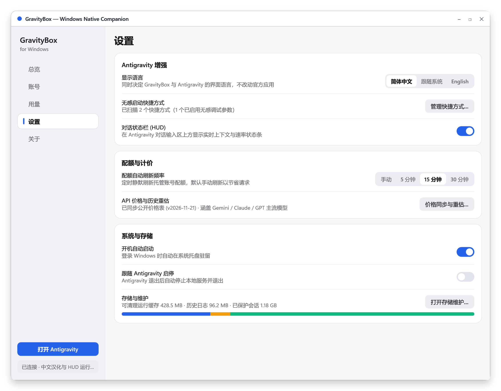
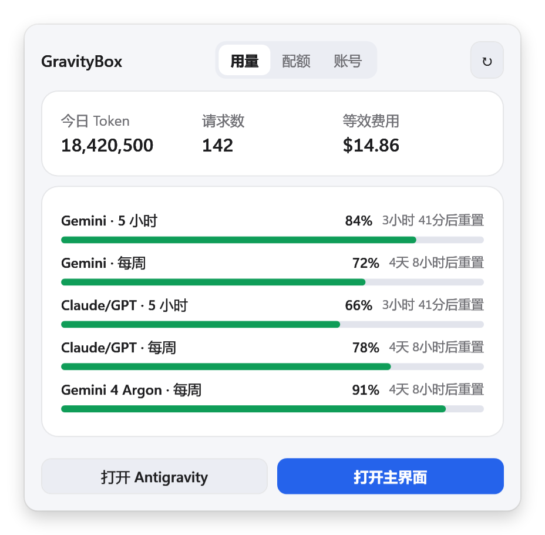
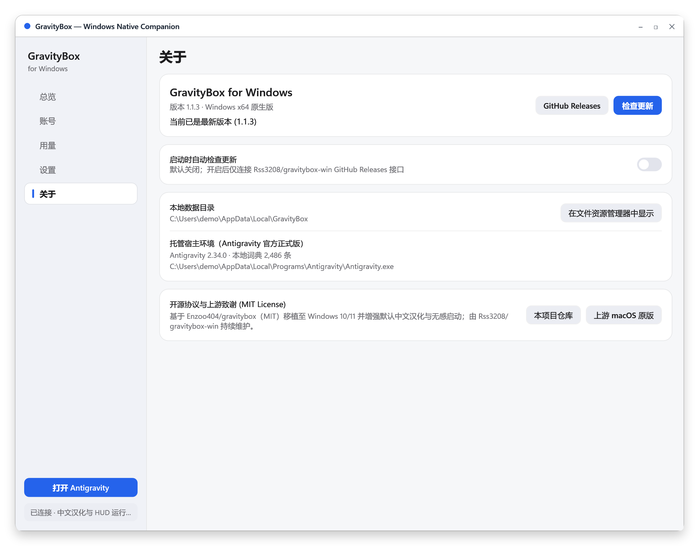
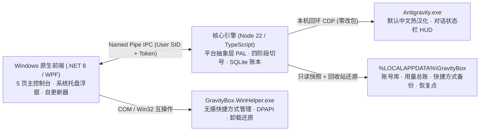

<div align="center">
  <a href="https://github.com/Rss3208/gravitybox-win">
    
  </a>

  <h1>GravityBox for Windows</h1>

  <p>
    <strong>面向 Windows 10 / 11 的 Google Antigravity 原生增强伴侣（开箱默认中文汉化）</strong><br />
    默认简体中文 · 无感快捷方式启动 · 输入框 Telemetry HUD · 双周期配额账单 · 多账号原子切号 · 可撤回缓存瘦身
  </p>

  <p>
    <a href="https://github.com/Rss3208/gravitybox-win/releases/latest"></a>
    <a href="https://github.com/Rss3208/gravitybox-win/actions/workflows/ci.yml"></a>
    
    
    <a href="./LICENSE"></a>
  </p>

  <p>
    <a href="./README.md">English</a> · <b>简体中文</b>
  </p>

  <p>
    <a href="#概览与特色">概览与特色</a> ·
    <a href="#快速上手">快速上手</a> ·
    <a href="#零改包默认中文汉化">默认中文汉化</a> ·
    <a href="#对话状态栏-hud">对话状态栏 HUD</a> ·
    <a href="#windows-原生控制台预览">界面预览</a> ·
    <a href="#安装升级与校验">安装与校验</a> ·
    <a href="#安全与隐私边界">安全边界</a> ·
    <a href="#架构与源码构建">源码构建</a> ·
    <a href="#上游致谢与开源协议">协议与致谢</a>
  </p>
</div>

<br />

> **开源致谢与说明**：本项目是基于优秀开源项目 [`Enzoo404/gravitybox`](https://github.com/Enzoo404/gravitybox)（MIT License）移植并增强的 **Windows 10 / 11 原生版本**。完整保留上游 MIT 许可证与提交历史，并在 Windows 端全新构建了 `.NET 8 WPF` 原生桌面客户端、`GravityBox.Win32` / `WinHelper` 原生桥、开箱默认简体中文汉化、无感 `.lnk` 快捷方式启动与 DPAPI 凭据隔离。macOS 用户推荐直接使用上游原版 [`Enzoo404/gravitybox`](https://github.com/Enzoo404/gravitybox)。

<div align="center">
  <picture>
    <source media="(prefers-color-scheme: dark)" srcset="assets/screenshots/win/win-hero-dark.png" />
    
  </picture>
  <sub><em>.NET 8 / WPF 原生主控制台与多屏 DPI 自适应系统托盘浮窗（跟随 Windows 浅色与深色主题自动切换）</em></sub>
</div>

---

## 概览与特色

**GravityBox for Windows**（`GravityBox v1.1.3`）专为 Windows 10 / 11 (`x64`) 官方正式版 `Antigravity.exe` 设计。安装包内置自包含 `.NET 8` 与 `Node 22` 运行环境，无需预先安装任何依赖；通过本机回环 CDP、当前用户 SID 级 Named Pipe 与只读 SQLite 事务运行，**不解包、不篡改、不重签名官方应用文件**。

| 核心能力 | 解决什么问题 |
| :--- | :--- |
| **开箱默认简体中文** | 首次启动即默认启用 `zh-Hans` 中文界面与 Antigravity 零改包动态汉化（覆盖 `2.23.0`–`2.34.0+`），支持随时一键切换 **简体中文 / 跟随系统 / English**，且严格保护对话正文、代码块与终端输出。 |
| **无感启动快捷方式** | 内置 `GravityBox.WinHelper.exe` 与快捷方式引导，支持一键为桌面/开始菜单的 Antigravity `.lnk` 快捷方式附加安全调试参数（自动备份原快捷方式，支持随时一键或卸载时自动无损还原）。配置后双击原图标即可自动汉化与加载 HUD。 |
| **对话状态栏 (HUD)** | 在每个聊天输入框下方嵌入三联遥测条，实时展示轮次用时、TTFT / TPS、Token 消耗、缓存命中率、压缩次数与上下文水位（支持中英双语独立开关）。 |
| **双周期配额与账单** | 将 **5 小时** 滚动限额、**每周** 限额与独立高阶池（如 `Gemini 4 Argon`）拆开展示；汇总页自动合并同一模型的思考档位变体（`-low` 至 `-max`），并按时序官方单价核算等效 API 费用与支持 CSV 导出。 |
| **多账号安全切换** | 支持一键保存当前账号、JSON 批量导入与安全导出、低配额备用智能推荐、同源 `agy` CLI 凭据非侵入同步，以及四阶段原子安全切换、7 天恢复点回滚与 Windows DPAPI 凭据加密。 |
| **可撤回缓存瘦身** | 按「运行缓存 / 历史日志 / 已保护核心资产」三类可视化扫描存储空间，清理统一移入 Windows 回收站并支持一键原位还原，登录凭据与聊天正文受白名单严格隔离保护。 |

---

## 快速上手

1. **下载与安装**：前往 [GitHub Releases](https://github.com/Rss3208/gravitybox-win/releases/latest) 下载任一版本：
   - **安装版（推荐）**：`GravityBox-1.1.3-win-x64-setup.exe`（每用户免管理员权限安装，自动创建开始菜单图标，卸载时自动无损还原 Antigravity 快捷方式）。
   - **便携版（免安装）**：`GravityBox-1.1.3-win-x64-portable.zip`（解压后直接运行 `GravityBox.exe`）。
   > **关于 Windows SmartScreen 提示**：开源社区版本未使用付费商业代码签名证书。若首次运行弹出「Windows 已保护你的电脑」，点击 **「更多信息 → 仍要运行」** 即可（也可先核对下方 `.sha256` 校验和或自行从源码构建）。
2. **启动并连接（默认中文生效）**：打开 **GravityBox** 后已默认启用简体中文。点击总览页 **「一键开启」** 无感启动快捷方式，或直接点击侧栏 **「打开 Antigravity」**。若 Antigravity 已在外部启动但未带调试端口，点击横幅 **「安全重启以连接」** 即可优雅重启挂载。
3. **三端协作**：写代码时看输入框下方 **HUD**；查额度与快速切号点击右下角 **系统托盘浮窗**（支持 `Ctrl+1/2/3`）；深度账单分析、多账号管理与快捷方式维护使用 **WPF 主控制台**（`Ctrl+1`–`5`）。

---

## 零改包默认中文汉化

安装并启动 GravityBox 后即**默认开启简体中文**（无需手动配置，随时可在设置中一键切回 `English` 或 `跟随系统`）。所有翻译均通过本机回环 CDP 在独立隔离世界动态注入，**绝不修改 `Antigravity.exe` 或 `app.asar`**，同时通过语义白名单严格隔离代码块、对话正文、输入框草稿与终端输出：

<div align="center">
  <picture>
    <source media="(prefers-color-scheme: dark)" srcset="assets/screenshots/win/win-i18n-compare-dark.png" />
    
  </picture>
  <sub><em>实机引擎注入对比：左侧原版英文 IDE → 右侧经 GravityBox 零改包实时汉化 + 底部 HUD 挂载（代码片段受白名单隔离保护）</em></sub>
</div>

---

## 对话状态栏 (HUD)

HUD 挂载于每个 Antigravity 对话输入框下方，支持分栏独立状态且不抢占输入焦点；悬停或点击胶囊即可向上展开 **对话统计**、**Token 用量** 与 **当前上下文** 实时卡片：

<div align="center">
  <picture>
    <source media="(prefers-color-scheme: dark)" srcset="assets/screenshots/win/win-i18n-hud-dark.png" />
    
  </picture>
  <sub><em>Windows Antigravity 中文界面 + 输入框底部三联 HUD 与「对话统计」展开面板（实时展示模型/工具耗时、TTFT、TPS 与子智能体步数）</em></sub>
</div>

<br />

<div align="center">
  <picture>
    <source media="(prefers-color-scheme: dark)" srcset="assets/screenshots/hud-capsules-dark.png" />
    
  </picture>
</div>

| 位置 | 示例读数 | 说明 |
| :--- | :--- | :--- |
| **1. 对话与速度** | 灰 / 实心蓝 / 呼吸蓝圆点 + `3 轮 · 本轮 18s · 90 tok/s · 2` | 状态灯指示当前前台活动（**灰** 空闲或仅后台子智能体运行，**实心蓝** 模型思考/输出，**呼吸蓝** 工具调用）；右侧依次为轮次、当前轮用时、平均吐字速度及并行子智能体数量。 |
| **2. Token 与缓存** | `58.6M tok · 缓存命中 97%` | 本会话（含关联子智能体）累计消耗总 Token 及输入缓存复用比例。 |
| **3. 上下文水位** | 压缩徽章 (`1` / `2` / `3+`) + 模型短标 + 进度条 (`66%`) | 发生自动压缩后显现对应颜色角标；多模型或编排场景显示当前模型简称；未返回精确容量时带 `~` 按参考上限估算。 |

### 向上展开详情卡片

悬停或点击任意胶囊可弹出明细卡片（`Esc` 或点击空白处收起）：

<table>
  <tr>
    <td width="33.3%" align="center">
      <b>对话统计</b><br /><br />
      <picture>
        <source media="(prefers-color-scheme: dark)" srcset="assets/screenshots/hud-card-session-dark.png" />
        
      </picture>
    </td>
    <td width="33.3%" align="center">
      <b>Token 用量</b><br /><br />
      <picture>
        <source media="(prefers-color-scheme: dark)" srcset="assets/screenshots/hud-card-tokens-dark.png" />
        
      </picture>
    </td>
    <td width="33.3%" align="center">
      <b>当前上下文 (v1.1.3)</b><br /><br />
      <picture>
        <source media="(prefers-color-scheme: dark)" srcset="assets/screenshots/hud-card-context-dark.png" />
        
      </picture>
    </td>
  </tr>
</table>

---

## Windows 原生控制台预览

所有界面截图均由 Windows WPF 原生客户端在浅色与深色模式下使用脱敏合成测试数据（`@example.invalid` / `C:\Users\demo\...`）于 2× 高清 DPI 渲染导出：

<table>
  <tr>
    <td width="50%" align="center">
      <b>总览（无感快捷方式引导 · 双周期配额 · 24h 曲线）</b><br /><br />
      <picture>
        <source media="(prefers-color-scheme: dark)" srcset="assets/screenshots/win/win-overview-dark.png" />
        
      </picture>
    </td>
    <td width="50%" align="center">
      <b>账号管理（多账号池 · 备用智能推荐 · 原子切换）</b><br /><br />
      <picture>
        <source media="(prefers-color-scheme: dark)" srcset="assets/screenshots/win/win-accounts-dark.png" />
        
      </picture>
    </td>
  </tr>
  <tr>
    <td width="50%" align="center">
      <b>用量与费用（Token 曲线 · 环形图 · 缓存命中 · CSV 导出）</b><br /><br />
      <picture>
        <source media="(prefers-color-scheme: dark)" srcset="assets/screenshots/win/win-usage-dark.png" />
        
      </picture>
    </td>
    <td width="50%" align="center">
      <b>设置（默认简体中文 · 快捷方式管理 · 存储瘦身）</b><br /><br />
      <picture>
        <source media="(prefers-color-scheme: dark)" srcset="assets/screenshots/win/win-settings-dark.png" />
        
      </picture>
    </td>
  </tr>
</table>

<details>
<summary>展开更多截图：系统托盘浮窗、关于与自更新页</summary>
<br />
<table>
  <tr>
    <td width="38%" align="center">
      <b>系统托盘悬浮窗</b><br /><br />
      <picture>
        <source media="(prefers-color-scheme: dark)" srcset="assets/screenshots/win/win-tray-dark.png" />
        
      </picture>
    </td>
    <td width="62%" align="center">
      <b>关于、自更新与 MIT 开源声明</b><br /><br />
      <picture>
        <source media="(prefers-color-scheme: dark)" srcset="assets/screenshots/win/win-about-dark.png" />
        
      </picture>
    </td>
  </tr>
</table>
</details>

---

## 安装、升级与校验

- **运行环境**：Windows 10 (1903+) 或 Windows 11 (`x64`)、官方正式版 Antigravity（通常位于 `%LOCALAPPDATA%\Programs\Antigravity\Antigravity.exe`）。安装包已内置自包含 `.NET 8` 与 `Node 22` 运行时，**无需预先安装 .NET 或 Node.js**。
- **PowerShell SHA-256 校验（推荐）**：
  ```powershell
  # 校验安装版
  Get-FileHash .\GravityBox-1.1.3-win-x64-setup.exe -Algorithm SHA256
  Get-Content .\GravityBox-1.1.3-win-x64-setup.exe.sha256

  # 或校验便携版
  Get-FileHash .\GravityBox-1.1.3-win-x64-portable.zip -Algorithm SHA256
  Get-Content .\GravityBox-1.1.3-win-x64-portable.zip.sha256
  ```
- **无损升级与自更新**：
  - 所有配置、账号库、用量总账、快捷方式备份与恢复点均保存在 `%LOCALAPPDATA%\GravityBox`。
  - 直接运行新版安装程序覆盖安装，或在 **「关于」** 页点击 **「检查更新」**（默认关闭后台检查；更新源指向 [`Rss3208/gravitybox-win`](https://github.com/Rss3208/gravitybox-win/releases) 并强制校验 `.sha256` 侧车文件）。
- **干净卸载**：通过 Windows「设置 → 应用」卸载安装版时会自动执行 `GravityBox.WinHelper.exe --restore-shortcuts` 无损恢复原 Antigravity 快捷方式；如需清空所有本地数据，删除 `%LOCALAPPDATA%\GravityBox` 即可。

<details>
<summary>进阶可选：为过期备用账号配置后台云端刷新凭据</summary>

日常使用（多账号切号、当前账号实时配额、HUD 状态栏、用量账单与汉化）**无需此配置**。仅当需要未激活备用账号在登录态过期后继续后台拉取云端配额时，可在 `%LOCALAPPDATA%\GravityBox\.env` 中写入兼容的 OAuth 客户端凭据：

```ini
GRAVITYBOX_GOOGLE_CLIENT_ID=your-client-id.apps.googleusercontent.com
GRAVITYBOX_GOOGLE_CLIENT_SECRET=your-client-secret
```

</details>

---

## 安全与隐私边界

| 安全原则 | Windows 工程实现 |
| :--- | :--- |
| **零遥测零上报** | 无第三方统计或崩溃上报 SDK，无静默外联请求；更新检查与远端价格同步默认均关闭。 |
| **不改动官方二进制** | 仅通过本机回环（`127.0.0.1`）CDP 隔离世界运行，绝不修改 `Antigravity.exe` 或 `resources/app.asar`。 |
| **DPAPI 凭据与 SID 隔离** | 本地账号凭据经 Windows **DPAPI (`DataProtectionScope.CurrentUser`)** 加密保护；前后端 IPC 使用绑定当前用户 SID 与 `ipc.token` 的 Named Pipe。 |
| **用户内容隔离与防误删** | 输入框草稿、对话正文、代码块、终端输出受 DOM 白名单保护；缓存清理统一走 Windows 回收站与 7 天恢复点，严禁硬删除核心数据。 |
| **自动化隐私与版权门禁** | 仓库内置 `tools/check-privacy.mjs` 与 `vendor/` 隔离门禁，不含任何官方二进制或真实用户数据。 |

---

## 架构与源码构建



### Windows 本地构建与打包

需安装 **Node.js `>=22.15.0 <23`** 与 **.NET 8 SDK**（如需构建 `setup.exe`，再安装 **Inno Setup 6**）：

```powershell
git clone https://github.com/Rss3208/gravitybox-win.git
cd gravitybox-win
npm ci

npm run build                    # 编译 TypeScript 后端与运行时脚本
npm run test:win                 # 运行 Windows 后端单元测试与平台契约测试
npm run test:win-native          # 运行 .NET 8 WPF / Win32 xUnit 测试套件
npm run check:privacy            # 运行隐私与路径泄露门禁
node tools/check-docs.mjs --source-only
npm run package:win              # 构建自包含便携 ZIP 与 Inno Setup setup.exe + .sha256
```

<details>
<summary>仓库目录结构</summary>

```text
gravitybox-win/
├── native-win/   # Windows .NET 8 解决方案（WPF 主应用、Win32 桥、WinHelper、xUnit 测试）
├── native/       # 上游 macOS Swift 6 / AppKit 前端（保留跨平台兼容）
├── src/          # Node 22 / TypeScript 核心引擎（含 src/platform/ 跨平台抽象层 PAL）
├── runtime/      # CDP 注入脚本（DOM 增量翻译引擎、保护守卫与双语 Telemetry HUD）
├── dict/         # 分层中文词典与本地覆盖配置
├── ui-strings/   # 各受支持正式版官方界面文案快照（2.23.0 – 2.34.0）
├── assets/       # 图标、i18n 语言包、模型目录、时序价格表与高 DPI 截图
├── docs/sdd/     # Windows 移植 Spec-Driven Development 需求/设计/执行与验收文档
├── test/         # Node 单元/集成测试、Windows 契约测试与无头浏览器 E2E 回归
└── tools/        # 构建、Windows 打包（tools/win/）、隐私扫描与文档一致性检查脚本
```

</details>

---

## 常见问题

<details>
<summary><b>为什么切号前需要先退出 Antigravity？</b></summary>

Antigravity 运行时会持续持有本地 SQLite（`state.vscdb`）与认证文件锁，强杀或覆写运行中的数据库存在损库与草稿丢失风险。GravityBox 会先等待官方进程优雅退出，再执行四阶段原子切换并在异常时自动回滚，切号动作始终由你确认。

</details>

<details>
<summary><b>只想开启输入框 HUD，保持 Antigravity 英文界面可以吗？</b></summary>

可以。在 **设置 → 显示语言** 中选择 **English**，同时保持 **对话状态栏 (HUD)** 开关开启，Antigravity 将保持原生英文界面并在输入框下方展示英文 HUD。

</details>

<details>
<summary><b>配置无感启动快捷方式会修改 Antigravity 本体吗？</b></summary>

不会。无感启动仅在桌面/开始菜单的 `.lnk` 快捷方式参数中追加官方支持的 `--remote-debugging-port=0`，并在修改前自动保存原始快捷方式备份；随时可在 **设置 → 管理快捷方式…** 中一键还原，卸载安装版时也会自动还原。

</details>

---

## 上游致谢与开源协议

- **开源协议**：本项目沿用上游 [**MIT License**](./LICENSE) 开源发布，完整保留原作者版权声明（`Copyright (c) 2026 Enzoo404`）与 Windows 移植衍生版权声明（`Copyright (c) 2026 Rss3208`）。
- **上游项目**：衷心感谢 [**Enzoo404/gravitybox**](https://github.com/Enzoo404/gravitybox) 打造了卓越的底层引擎、零改包汉化架构、Telemetry HUD、双周期配额与安全切号模型；如使用 macOS，请直接支持原版仓库。
- **第三方许可与免责声明**：详见 [`THIRD_PARTY_NOTICES.md`](./THIRD_PARTY_NOTICES.md)。
- **参与贡献与反馈**：欢迎阅读 [`CONTRIBUTING.md`](./CONTRIBUTING.md)、[`CODE_OF_CONDUCT.md`](./CODE_OF_CONDUCT.md)、[`SECURITY.md`](./SECURITY.md) 与 [`CHANGELOG.md`](./CHANGELOG.md)，在 [GitHub Issues](https://github.com/Rss3208/gravitybox-win/issues) 提交建议或问题反馈。

<p align="center">
  <sub>基于 <a href="./LICENSE">MIT License</a> 开源 · 移植自 <a href="https://github.com/Enzoo404/gravitybox">Enzoo404/gravitybox</a> · 第三方许可见 <a href="./THIRD_PARTY_NOTICES.md">THIRD_PARTY_NOTICES.md</a> · 与 Google / Antigravity / Microsoft 无从属或背书关系。</sub>
</p>
