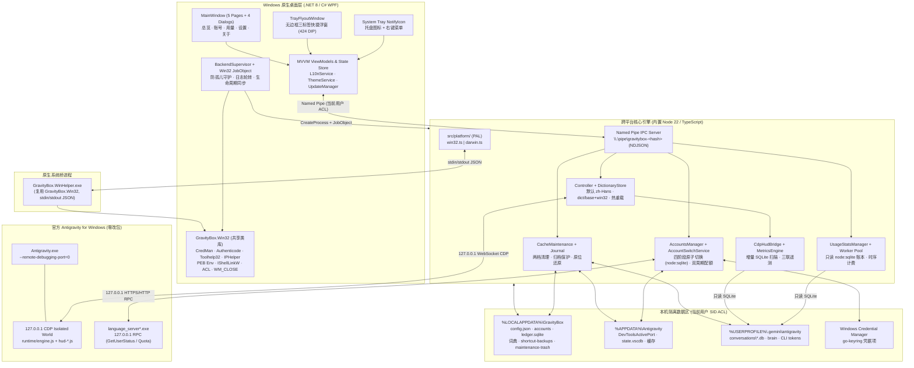
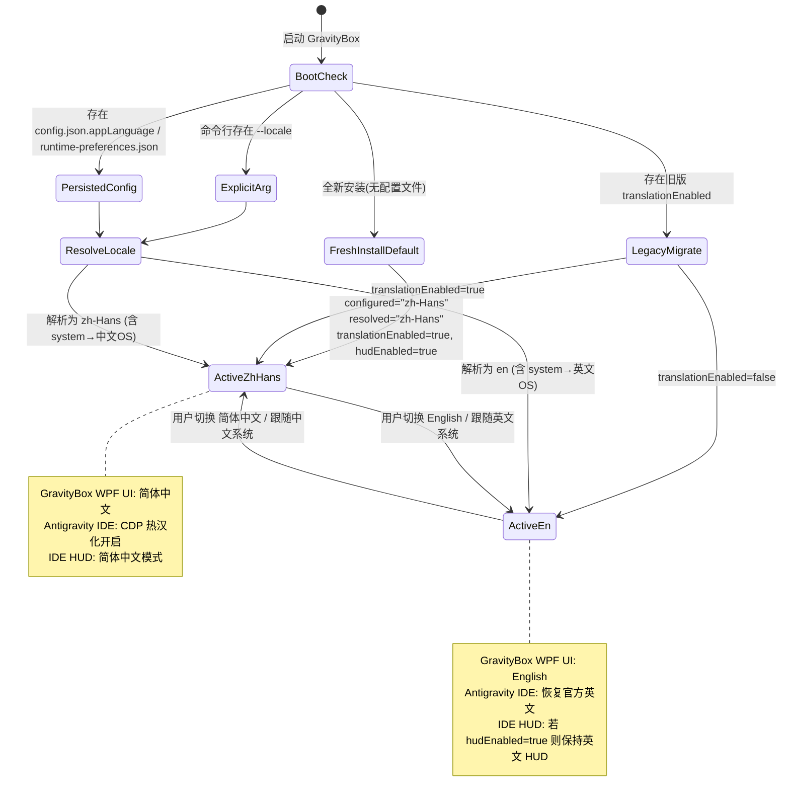

# GravityBox for Windows — 详细架构与技术设计文档（HLD + LLD）

> **文档编号**：`SDD-DES-WIN-001`  
> **关联需求**：[`01-requirements.md`](./01-requirements.md)（`SDD-REQ-WIN-001`）  
> **基线版本**：`GravityBox v1.1.3`  
> **目标架构**：`.NET 8 / C# (WPF + Fluent/Mica)` 原生前端 + `GravityBox.Win32` 原生系统桥 + 跨平台 `Node 22 / TypeScript` 核心后端

---

## 1. 架构决策记录（Architecture Decision Records）

| ADR 编号 | 决策主题 | 最终选型 | 备选方案与取舍依据 |
| :--- | :--- | :--- | :--- |
| **ADR-001** | Windows 原生桌面框架 | **`.NET 8` WPF (`net8.0-windows10.0.19041.0`) + 自定义 Fluent/Mica Design Tokens + MVVM (`CommunityToolkit.Mvvm`)** | 对比 WinUI 3：WinUI 3 的系统托盘无边框自适应浮窗（多屏高 DPI 贴靠 + 外部点击自动收起）及非 MSIX 自包含部署存在明显坑点，且 CI 无头测试复杂；WPF 在 `.NET 8` 上成熟稳定、支持 DWM Backdrop（Mica/Acrylic）与精确自定义绘制（环图/折线图/进度条），直接对标原版 `Swift/AppKit`，且严格采用 MVVM 分层确保视图层可替换。 |
| **ADR-002** | 跨平台后端解耦模式 | **在 `src/platform/` 引入平台抽象层（PAL）**，按 `process.platform` 静态/工厂分发 `darwin.ts` 与 `win32.ts` | 避免在 15+ 业务文件中散落 `if (process.platform === 'win32')`；保证 `src/` 与 `runtime/` 逻辑复用率 ≥ 90%，macOS 侧行为与既有单测零退化。 |
| **ADR-003** | Windows 本地 IPC 通道 | **Windows Named Pipe**（`\\.\pipe\gravitybox-<sha256(normalizedStateDir).slice(0,24)>`），沿用现有 NDJSON 帧格式 | 替代 macOS `control.sock`：Node `net.createServer/createConnection` 与 C# `NamedPipeClientStream` 均原生支持 Named Pipe，无文件系统残余 socket 文件与 `lstat` 路径长度（104 字节）限制，且可通过 `PipeSecurity` 严格限定当前用户 SID 访问。 |
| **ADR-004** | 切号 SQLite 事务引擎 | **以 Node 22 内置 `node:sqlite` (`DatabaseSync`) 替换 `account-switch.ts` 中的 `/usr/bin/sqlite3` 子进程** | 项目在 `sqlite-worker.ts` 与 `usage-ledger-worker.ts` 中已全面使用 `node:sqlite`；将 `DatabaseTransaction` 统一迁移至 `DatabaseSync` 后，Windows 与 macOS 均实现零外部 `sqlite3` CLI 依赖、无 stdin 文本解析风险且原子事务更可控。 |
| **ADR-005** | Windows 凭据读写与多账号同步 | **Windows Credential Manager（`CredReadW`/`CredWriteW`/`CredDeleteW`）+ `state.vscdb` + `~/.gemini` CLI 文件** | 对标 macOS Keychain（`go-keyring`）；由于 Go `zalando/go-keyring` 在 Windows 上使用 Win32 Credential Manager，经 Day-0 (`CHK-04`) 冻结精确 `TargetName` 映射规则后通过 `Win32CredentialAdapter` 读写，并保持 `go-keyring-base64:<b64>` 载荷格式一致。 |
| **ADR-006** | 默认简体中文与无感启动汉化 | **全新安装默认 `appLanguage = "zh-Hans"`**；新增 `dict/win32.json` 平台词典层；通过 COM `IShellLinkW` 提供**可选、备份可逆**的快捷方式 `--remote-debugging-port=0` 参数管理 | 彻底解决英文 Windows 系统下 `system` 策略误关汉化及桌面图标直启无调试端口的问题；坚持 100% 零改包原则（绝不触碰 `Antigravity.exe`/`app.asar`）。 |
| **ADR-007** | Node 调用 Win32 原生能力方案 | **共享 C# 库 `GravityBox.Win32` + 轻量辅助进程 `GravityBox.WinHelper.exe`（stdin/stdout JSON-RPC）** | 替代 `/bin/ps`、`lsof`、`security`、`codesign`、`PlistBuddy`；避免反复拉起缓慢且受策略限制的 `powershell.exe`，避免引入 C++ `node-gyp` 原生扩展（保持 `package.json` 零生产依赖），实现 < 5ms 级 Win32 API 探测（Toolhelp32 / IPHelper / PEB 环境变量 / Authenticode / CredMan / IShellLinkW / NTFS ACL）且零 `argv` 凭据泄露。 |
| **ADR-008** | Windows 文件安全校验、进程锁与缓存保险库 | 1) 以 **文件类型 + ReparsePoint 拒绝 + 当前用户 SID 所有权检查** 替代 `info.uid !== process.getuid?.()`；2) 进程锁改用 `open('wx')` 独占创建 + PID 存活探测（兼容 Win32 错误码）；3) 缓存统一移入同盘保险库 `%LOCALAPPDATA%\GravityBox\maintenance-trash`（支持跨卷安全复制-校验-删除回退） | 解决 Windows 上 `process.getuid` 为 `undefined` 导致全线报错、`link()` 跨卷失效及 NTFS 文件锁问题。 |

---

## 2. 系统总体架构

### 2.1 运行时架构与进程边界



### 2.2 核心模块复用与演进目录结构

保持上游 macOS 目录完整不变，新增目录严格隔离：

```text
gravitybox/
├── src/
│   ├── platform/                  # [新增] 跨平台抽象层 (PAL)
│   │   ├── types.ts               # PlatformAdapter 统一契约
│   │   ├── paths.ts               # 跨平台默认路径解析 (state/cache/logs/app/profile/trash)
│   │   ├── security.ts            # 跨平台文件所有权校验、ACL 保护、路径脱敏
│   │   ├── darwin.ts              # macOS 实现 (迁移原有 /bin/ps, lsof, codesign, security 等)
│   │   ├── win32.ts               # Windows 实现 (对接 WinHelper JSON-RPC + Win32 策略)
│   │   ├── win-helper-client.ts   # GravityBox.WinHelper 持久/按需 stdio JSON-RPC 客户端
│   │   ├── shortcuts.ts           # Windows .lnk 快捷方式扫描/备份/补参/还原业务编排
│   │   └── index.ts               # 平台单例与测试注入入口
│   ├── account-db-tx.ts           # [新增] 基于 node:sqlite DatabaseSync 的跨平台切号事务
│   ├── (既有 50+ .ts 文件)        # [小幅重构] 去除硬编码 POSIX 路径/命令，调用 src/platform/
├── runtime/                       # [复用 ≥98%] 仅在 engine.js/hud-styles.js 补充 Windows 字体与快捷键细节
├── dict/
│   ├── base.json                  # [复用] 5455+ 条既有词典
│   └── win32.json                 # [新增] Windows 专属菜单/快捷键/系统交互补充词典
├── assets/
│   ├── i18n/                      # [扩展] 补充 Windows 专属文案键（资源管理器、任务栏、快捷方式引导等）
│   └── AppIcon.ico                # [新增] 多分辨率 Windows ICO（16/24/32/48/64/128/256px）+ 托盘状态图标
├── native/                        # [保留不动] macOS Swift 6 / AppKit 前端
├── native-win/                    # [新增] Windows .NET 8 解决方案
│   ├── GravityBox.sln
│   ├── GravityBox.Win32/          # 共享 Win32 P/Invoke 与 COM 封装类库 (零 UI 依赖)
│   ├── GravityBox.WinHelper/      # 供 Node 后端调用的轻量 stdio JSON-RPC 原生桥
│   ├── GravityBox.App/            # .NET 8 WPF 桌面主程序 (MVVM + 托盘浮窗 + 5 页 + 4 弹窗)
│   └── GravityBox.Tests/          # xUnit 单元测试与 MVVM/UI 契约测试
├── tools/
│   ├── win/                       # [新增] Windows 构建、图标生成、Inno Setup/Portable 打包、验收门禁
│   │   ├── build-win.mjs
│   │   ├── package-win.mjs
│   │   ├── generate-win-icons.mjs
│   │   ├── setup-test-browser-win.mjs
│   │   └── installer.iss          # Inno Setup 安装脚本 (Per-User 免 UAC + 卸载还原快捷方式)
│   └── (既有脚本跨平台化)          # doctor.mjs, verify.mjs, run-tests.mjs, check-privacy.mjs 等
├── test/
│   ├── win/                       # [新增] Windows 平台契约、Named Pipe、快捷方式、默认汉化专项测试
│   └── (既有测试兼容跨平台)
└── docs/sdd/                      # [本套文档] 需求 / 设计 / 执行规格说明书
```

---

## 3. 全量 POSIX / macOS 耦合点审计与重构映射

基于对仓库源码的逐文件静态审计，以下为全部需要经 PAL 解耦的 macOS 强耦合清单（覆盖 `src/` 全部 14 个受影响文件）：

| 既有文件 | 耦合位置与原逻辑 | Windows 替代方案 |
| :--- | :--- | :--- |
| `src/files.ts` | L17/L89/L122：`info.uid !== process.getuid?.()`；L29：`renameSync` 无 `EPERM`/`EBUSY` 重试；L60：`lastIndexOf('/')` | `assertOwnedRegularFile()`（Windows 校验非符号链接/非 ReparsePoint + 当前用户 SID）；`atomicRenameSyncWithRetry()` 处理防病毒瞬时锁（最多 5 次 10–80ms 退避）；`basename()` 替换硬编码 `/` |
| `src/process-lock.ts` | L20：`link(temporary, path)`；L31：`uid` 校验；L41：`/usr/sbin/lsof -t -- path`；L48：`process.kill(pid, 0)` | 统一 `open(path, 'wx')` 原子创建 + 写入 `{pid, nonce, createdAt}`；Windows 通过 `WinHelper.isProcessAlive(pid)`（校验 PID 存在且进程创建时间匹配防止 PID 复用）及独占句柄尝试检测孤儿锁 |
| `src/main.ts` | L64：路径脱敏仅匹配 `/Users/demo/...` 等 POSIX 路径；L361/401/454/485：`~/Library/Application Support/...`、`~/.Trash`；L362/417/599/1590：`control.sock` + `lstat.isSocket()` + `umask`/`chmod`；L625–641：初始语言解析；L1068–1091：`/bin/ps` 切号预检 | 使用 `platform.getDefaultPaths()`、`platform.getIpcEndpoint(stateDir)`（Named Pipe）、`platform.createIpcServer()`（含当前用户 SID ACL）、`platform.sanitizePaths()`（增加 `[A-Za-z]:\\Users\\[^\\]+` 脱敏）、`platform.listProcesses()`；首次安装默认 `zh-Hans` |
| `src/application-target.ts` | L48：`Contents/Resources/app.asar`；L103–140：`/Applications/Antigravity.app`、`Library/Application Support`；L168：`Contents/Resources/bin/language_server` | 通过 `platform.resolveAppLayout(appPath)` 抽象出 `asarPath`、`executablePath`、`languageServerGlob`、`defaultProfileDir`、`defaultAppCandidates`（`%LOCALAPPDATA%\Programs\Antigravity`、`%ProgramFiles%\Antigravity`） |
| `src/discovery.ts` | L42：`Library/Caches/GravityBox`；L93–130：`Info.plist`、`_CodeSignature`、`PlistBuddy`、`codesign`、`TeamIdentifier=EQHXZ8M8AV`；L183/188/253/296：`/usr/sbin/lsof`；L219：`/bin/ps` | `platform.inspectInstalledBundle(appPath)`：读取 PE `FileVersionInfo` + `app.asar/package.json` 版本号 + `WinVerifyTrust` 校验 Google Authenticode 签名；`platform.findTcpListenersByPort(port)` 与 `platform.findTcpListenersByPid(pid)` 基于 Win32 `GetExtendedTcpTable` + `QueryFullProcessImageNameW` |
| `src/account-keychain.ts` | L16/35/65：`/usr/bin/security` | 工厂创建 `SystemKeychainAdapter`：macOS 走 `/usr/bin/security`，Windows 走 `Win32CredentialAdapter`（经 `WinHelper` 调用 `CredReadW`/`CredWriteW`/`CredDeleteW`） |
| `src/account-switch.ts` | L66：`/usr/bin/sqlite3` 子进程；L152：`endsWith('/accounts.json')`；L186：`Library/Application Support`；L208/361：`uid` 校验；L275：`startsWith(dir + '/')`；L321–324：`/bin/ps` 与 `/Applications/...` | `DatabaseTransaction` 统一重构为基于 `node:sqlite` `DatabaseSync`（见 4.6 节）；所有路径拼接与前缀判断统一使用 `sep` / `isStrictSubpath()` + 大小写归一化；进程守卫调用 `platform.isAnyAntigravityRunning()` |
| `src/account-probe.ts` | L116/605：`/bin/ps`（含 `-E` 读环境变量）；L137：`/usr/sbin/lsof`；L151/180：`Contents/Resources/bin/language_server` | `platform.findLanguageServerCandidates()` + `platform.readProcessEnvVar(pid, 'ANTIGRAVITY_SERVER_CSRF_TOKEN')`（Win32 PEB 读取）+ `platform.findTcpListenersByPid(pid)` |
| `src/accounts.ts` | L271：`/bin/ps`；L867/1206：`process.getuid?.()`；L1770/1772/1787/2530：`Library/Application Support`；L343：`startsWith(this.accountsDir + '/')` | 全部切换至 `platform.getDefaultPaths()`、`platform.listProcesses()`、`assertOwnedPath()` 及跨平台路径前缀校验 |
| `src/maintenance.ts` & `maintenance-catalog.ts` & `maintenance-journal.ts` | `~/.Trash`、`Library/Caches/GravityBox`、`/bin/ps`、`Contents/MacOS/`、`stat.uid !== process.getuid?.()`、`dev:ino` 与跨卷 `rename` | Windows 主保险库默认设于 `%LOCALAPPDATA%\GravityBox\maintenance-trash`（同盘原子 `rename`，跨卷安全 copy+verify+rm）；进程检测走 `platform.listProcesses()`；文件身份标识在 Windows 使用 `dev:ino`（Node `stat({ bigint: true })` 返回 NTFS `VolumeSerialNumber` + `FileIndex`）；`isStrictSubpath` 在 Windows 启用大小写不敏感比对 |
| `src/usage.ts` & `src/usage-ledger-worker.ts` | `Library/Application Support/GravityBox`、`Library/Caches/GravityBox`、`stat.uid !== process.getuid?.()` | 切换至 `platform.getDefaultPaths()` 与 `assertOwnedRegularFile()` |
| `src/bundle-cache.ts` & `src/coverage.ts` & `src/pricing-catalog-runtime.ts` | `Contents/Resources/app.asar`、`Contents/Info.plist`、`PlistBuddy`、`uid` 校验 | 统一通过 `platform.resolveAppLayout(appPath)` 获取资源目录与版本号读取接口 |
| `src/i18n.ts` | L148–161：仅在 `darwin` 读取 `defaults read -g AppleLanguages`；L231–235：全新安装默认返回 `'system'` | Windows 读取 `GetUserPreferredUILanguages`（通过 `WinHelper` 或 `Intl` 兜底）；全新安装默认语言策略按 `FR-001` 返回 `zh-Hans`（可通过显式配置覆盖） |
| `src/controller.ts` | L1019：macOS 专属默认菜单名列表 | 保留 macOS 列表，在 Windows 追加 `Exit`、`Preferences`、`File/Edit/Selection/View/Go/Run/Terminal/Help` 基准集 |

---

## 4. 模块级详细设计（Low-Level Design）

### 4.1 跨平台抽象层（`src/platform/`）

#### 4.1.1 核心接口定义（`src/platform/types.ts`）

```typescript
export type PlatformId = 'darwin' | 'win32';

export interface PlatformPaths {
  stateDir: string;           // win32: %LOCALAPPDATA%\GravityBox
  cacheDir: string;           // win32: %LOCALAPPDATA%\GravityBox\cache
  logDir: string;             // win32: %LOCALAPPDATA%\GravityBox\logs
  defaultTrashDir: string;    // win32: %LOCALAPPDATA%\GravityBox\maintenance-trash
  appSupportDir: string;      // win32: %APPDATA%
  defaultAntigravityProfile: string; // win32: %APPDATA%\Antigravity
  defaultGeminiDir: string;   // win32: %USERPROFILE%\.gemini
  defaultAppCandidates: string[]; // [%LOCALAPPDATA%\Programs\Antigravity, %ProgramFiles%\Antigravity]
}

export interface AppBundleLayout {
  appRoot: string;            // win32: C:\Users\<user>\AppData\Local\Programs\Antigravity
  executablePath: string;     // win32: <appRoot>\Antigravity.exe
  resourcesDir: string;       // win32: <appRoot>\resources
  asarPath: string;           // win32: <appRoot>\resources\app.asar
  asarUnpackedPath: string;   // win32: <appRoot>\resources\app.asar.unpacked
  binDir: string;             // win32: <appRoot>\resources\bin (按 CHK-01 最终冻结)
  languageServerExePattern: RegExp; // /^language_server.*\.exe$/i
  versionSourcePath: string;  // win32: <appRoot>\Antigravity.exe 或 <appRoot>\resources\app.asar
}

export interface ProcessEntry {
  pid: number;
  parentPid: number;
  executablePath: string;     // 完整规范化路径
  commandLine: string;
  cpuPercent?: number;
  creationTimeMs?: number;    // 防 PID 复用校验
}

export interface TcpListenerEntry {
  pid: number;
  localAddress: string;       // "127.0.0.1" | "::1" | "0.0.0.0" | ...
  localPort: number;
  executablePath: string;
}

export interface VerifiedBundleInfo {
  version: string;
  productName: string;
  publisherVerified: boolean;
  signatureFingerprint: string; // win32: 签名证书 Thumbprint 或 exe+asar 元数据指纹
  legacyPatch: boolean;
}

export interface PlatformAdapter {
  readonly id: PlatformId;
  getDefaultPaths(homeDir?: string): PlatformPaths;
  resolveAppLayout(appPath: string): AppBundleLayout;
  detectInstalledAppPath(overrideDir?: string): string | null;
  isInsidersPath(appOrProfilePath: string): boolean;

  // IPC
  getIpcEndpoint(stateDir: string): string;
  createIpcServer(endpoint: string, onConnection: (socket: import('node:net').Socket) => void): Promise<import('node:net').Server>;
  verifyIpcEndpoint(endpoint: string): Promise<void>;
  cleanupIpcEndpoint(endpoint: string): Promise<void>;

  // 安全与文件系统
  assertOwnedPath(targetPath: string, expectedType: 'file' | 'dir' | 'any'): Promise<void>;
  hardenDirectoryPermissions(dirPath: string): Promise<void>;
  hardenFilePermissions(filePath: string): Promise<void>;
  isStrictSubpath(parentDir: string, candidatePath: string): boolean;
  sanitizeHostPaths(message: string, token: string): string;

  // 进程、网络、验真与环境变量
  listProcesses(): Promise<ProcessEntry[]>;
  isProcessAlive(pid: number, expectedCreationTimeMs?: number): Promise<boolean>;
  findTcpListenersByPort(port: number): Promise<TcpListenerEntry[]>;
  findTcpListenersByPid(pid: number): Promise<TcpListenerEntry[]>;
  readProcessEnvVar(pid: number, varName: string): Promise<string | null>;
  verifyOfficialApp(appPath: string): Promise<VerifiedBundleInfo>;
  readAppVersionFast(appPath: string): Promise<string>;

  // 系统语言与凭据
  detectOsPreferredLocales(): string[];
  createKeychainAdapter(): import('../account-keychain.js').KeychainAdapter;

  // Windows 扩展（macOS 返回 unsupported/empty）
  scanAntigravityShortcuts?(): Promise<ShortcutEntry[]>;
  applyShortcutDebugPort?(paths: string[], stateDir: string): Promise<ShortcutApplyResult>;
  restoreShortcutDebugPort?(stateDir: string, paths?: string[]): Promise<ShortcutRestoreResult>;
}
```

#### 4.1.2 路径映射总表（macOS vs Windows）

| 逻辑资产 | macOS 路径 | Windows 标准路径 | 备注 |
| :--- | :--- | :--- | :--- |
| GravityBox 状态与数据根目录 | `~/Library/Application Support/GravityBox` | `%LOCALAPPDATA%\GravityBox` | 含 `config.json`、`accounts.json`、`accounts\`、`usage-ledger.sqlite`、`词典\`、`.env`、`shortcut-backups.json` |
| GravityBox 磁盘缓存目录 | `~/Library/Caches/GravityBox` | `%LOCALAPPDATA%\GravityBox\cache` | `bundle-verify-cache-v1.json`、`usage-db-cache-*.json` |
| GravityBox 运行日志目录 | `~/Library/Logs/GravityBox` | `%LOCALAPPDATA%\GravityBox\logs` | `backend.log` + `归档\backend-*.log` |
| GravityBox 缓存恢复保险库 | `~/.Trash`（回退至 `stateDir/maintenance-trash`） | `%LOCALAPPDATA%\GravityBox\maintenance-trash` | 同盘 NTFS 原子移动，支持一键原位还原；提供「清空旧快照至系统回收站」 |
| 官方 Antigravity 安装目录 | `/Applications/Antigravity.app` | `%LOCALAPPDATA%\Programs\Antigravity`（备选 `%ProgramFiles%\Antigravity`） | 按 `CHK-01` 实机核验结果补充注册表 `Uninstall` 键自动探测 |
| 官方 Antigravity 配置目录 | `~/Library/Application Support/Antigravity` | `%APPDATA%\Antigravity` | 含 `DevToolsActivePort`、`User\globalStorage\state.vscdb`、`Cache`、`GPUCache` 等 |
| Gemini / Agent 对话目录 | `~/.gemini` | `%USERPROFILE%\.gemini` | 含 `antigravity\conversations\*.db`、`brain\`、`conversation_summaries.db`、`config\plugins`、`antigravity-cli\` |
| IPC 监听端点 | `<stateDir>/control.sock` | `\\.\pipe\gravitybox-<sha256(lower(resolve(stateDir))).slice(0,24)>` | 隔离多套测试沙箱目录，零冲突 |

---

### 4.2 原生系统桥设计（`GravityBox.Win32` + `GravityBox.WinHelper`）

#### 4.2.1 为什么采用持久/轻量 stdio JSON-RPC Helper
Node 22 后端需要调用 7 类 Win32 原生 API。通过在同一 `.NET 8` 解决方案中构建 `GravityBox.Win32` 类库并包装为无窗口控制台 `GravityBox.WinHelper.exe`：
- **安全**：所有请求/响应走匿名 `stdin`/`stdout` 管道（UTF-8 NDJSON），凭据绝不出现在进程 `argv` 或临时文件中。
- **高性能**：`WinHelperClient` 维护一个按需拉起、空闲 60 秒自动回收的长驻子进程（并绑定父进程退出自动销毁），单次 `list_processes` / `tcp_listeners` / `cred_read` 耗时 **< 5ms**（比每次起 PowerShell 快 50–100 倍）。
- **零外部依赖**：打包后与 WPF 主程序共享同一 `.NET 8` 运行时目录，几乎零额外体积增量（~100KB 程序集）。

#### 4.2.2 `GravityBox.WinHelper` RPC 方法表

| Method | 输入参数 | 输出结构 | 底层 Win32 API |
| :--- | :--- | :--- | :--- |
| `list_processes` | `{ nameFilter?: string }` | `{ processes: ProcessEntry[] }` | `CreateToolhelp32Snapshot` + `OpenProcess(PROCESS_QUERY_LIMITED_INFORMATION \| PROCESS_VM_READ)` + `QueryFullProcessImageNameW` + `NtQueryInformationProcess(ProcessBasicInformation)` 读 PEB `CommandLine` |
| `is_process_alive` | `{ pid: number, creationTimeMs?: number }` | `{ alive: boolean, creationTimeMs?: number }` | `OpenProcess(PROCESS_QUERY_LIMITED_INFORMATION)` + `GetExitCodeProcess` + `GetProcessTimes` |
| `read_process_env` | `{ pid: number, name: string }` | `{ value: string \| null }` | `NtQueryInformationProcess` + `ReadProcessMemory` 读取同用户目标进程 PEB `RTL_USER_PROCESS_PARAMETERS.Environment` 块，精确提取指定键（绝不返回全量环境变量） |
| `tcp_listeners` | `{ port?: number, pid?: number }` | `{ listeners: TcpListenerEntry[] }` | `iphlpapi.dll` `GetExtendedTcpTable(TCP_TABLE_OWNER_PID_LISTENER)`（同时查 `AF_INET` 与 `AF_INET6`）+ `QueryFullProcessImageNameW` |
| `verify_authenticode` | `{ path: string }` | `{ valid: boolean, subject: string, issuer: string, thumbprint: string, fileVersion: string, productName: string }` | `wintrust.dll` `WinVerifyTrust(WINTRUST_ACTION_GENERIC_VERIFY_V2)` + `X509Certificate2.CreateFromSignedFile` + `FileVersionInfo.GetVersionInfo` |
| `cred_read` | `{ target: string }` | `{ secret: string \| null, userName?: string }` | `advapi32.dll` `CredReadW(CRED_TYPE_GENERIC)` |
| `cred_write` | `{ target: string, userName: string, secret: string }` | `{ ok: true }` | `advapi32.dll` `CredWriteW(CRED_TYPE_GENERIC, CRED_PERSIST_LOCAL_MACHINE/ENTERPRISE)` |
| `cred_delete` | `{ target: string }` | `{ ok: true, existed: boolean }` | `advapi32.dll` `CredDeleteW(CRED_TYPE_GENERIC)` |
| `acl_harden` | `{ path: string, isDir: boolean }` | `{ ok: true }` | `FileSecurity`/`DirectorySecurity` 禁用继承（`SetAccessRuleProtection(true, false)`），仅授予当前用户 SID（`WindowsIdentity.GetCurrent().User`）与 `SYSTEM` 完全控制 |
| `acl_verify_owner` | `{ path: string }` | `{ ownedByCurrentUser: boolean, isReparsePoint: boolean, exists: boolean }` | `File.GetAttributes` 检查 `FileAttributes.ReparsePoint` + `GetAccessControl().GetOwner(typeof(SecurityIdentifier))` 比对当前用户 SID（允许当前用户或管理员组拥有且排除非授权用户写权限） |
| `shortcut_scan` | `{ officialExePath: string }` | `{ shortcuts: ShortcutEntry[] }` | COM `IShellLinkW` + `IPersistFile` 扫描桌面 / 开始菜单 / 任务栏 `.lnk` |
| `shortcut_set_args` | `{ path: string, arguments: string }` | `{ ok: true }` | COM `IShellLinkW.SetArguments` + `IPersistFile.Save` |
| `recycle_delete` | `{ paths: string[] }` | `{ ok: true }` | Shell `IFileOperation`（`FOF_ALLOWUNDO | FOF_SILENT | FOF_NOCONFIRMATION`）移入 Windows 回收站 |
| `ui_languages` | `{}` | `{ locales: string[] }` | `kernel32.dll` `GetUserPreferredUILanguages(MUI_LANGUAGE_NAME)` |

> **关键设计细节 — 64 位 PEB 读取与权限边界**：
> - `GravityBox.WinHelper.exe` 与 `Antigravity.exe`、`language_server*.exe` 均运行在**同一当前登录用户会话**、同为 `x64` 进程，因此无需管理员权限即可对同用户进程调用 `OpenProcess(PROCESS_QUERY_LIMITED_INFORMATION | PROCESS_VM_READ)` 读取 PEB 命令行与 `ANTIGRAVITY_SERVER_CSRF_TOKEN`。
> - 仅提取精确键名 `ANTIGRAVITY_SERVER_CSRF_TOKEN`，绝不将完整环境变量块返回给 Node 或写入任何日志。
> - **容错降级**：若个别安全软件拦截 `PROCESS_VM_READ`，`read_process_env` 返回 `null` 而不崩溃，回退至命令行 `--csrf_token` 或 `state.vscdb` + 缓存配额方案，并在诊断日志记录脱敏告警。

---

### 4.3 Named Pipe IPC 与安全隔离设计

#### 4.3.1 端点命名与隔离规则
- 端点计算公式：
  ```ts
  const normalized = resolve(stateDir).toLowerCase();
  const hash = createHash('sha256').update(normalized).digest('hex').slice(0, 24);
  const pipeName = `\\\\.\\pipe\\gravitybox-${hash}`;
  ```
- 不同 `--state-dir`（如开发、测试沙箱、生产环境）自动映射到互不干扰的 Named Pipe，100% 保留既有 `test/ipc*.test.mjs` 的并发沙箱隔离能力。

#### 4.3.2 Named Pipe 访问控制（防跨用户本地劫持）
- **问题**：Node.js `net.createServer().listen('\\\\.\\pipe\\...')` 默认由 libuv 创建 Named Pipe，其默认 DACL 可能允许 `Everyone` 或低完整性进程连接。
- **方案**：
  1. Node 服务端在启动监听后，立即通过 `WinHelper`（或内置单次握手鉴权令牌）落实双层防护：
     - **内核 ACL 层**：通过 `stateDir`（受当前用户 SID 独占 ACL 保护）生成高熵会话密钥文件 `%LOCALAPPDATA%\GravityBox\ipc.token`（每次后端启动重新生成 32 字节随机 hex，设置仅当前用户 SID 可读 ACL）。
     - **协议校验层**：Windows 下每个 NDJSON IPC 请求可附带 `authToken` 字段（或首包校验），WPF 客户端启动前读取同目录下的 `ipc.token` 并在请求中携带，后端采用 `crypto.timingSafeEqual` 校验；无合法 `authToken` 立即断开连接（macOS Unix Socket 已有 `0600` + `uid` 内核校验，兼容保留无需破坏既有 macOS 客户端）。
  2. **单实例互斥**：在创建监听前仍保留 `acquireProcessLease(join(stateDir, 'backend.lock'), 0)`，并尝试连接已有 `pipeName` 发送 `{ command: "ping" }` 判断旧后端是否存活。

#### 4.3.3 C# 客户端桥接（`BackendBridge.cs`）
- 完全复刻 `native/Backend.swift` 的并发与流控模型：
  - **读通道**：只读命令集合（`status`、`dashboard_summary`、`account_list`、`usage_summary`、`maintenance_scan`、`quota_refresh` 等）通过 `SemaphoreSlim(8, 8)` 并发执行，超时 `8s`（`status`/`task_list`）或 `45s`。
  - **写通道**：变更类命令通过单并发队列（`SemaphoreSlim(1, 1)`）串行化，避免与后端 `commandChain` 产生竞态；`account_switch` 预算 `65s`，`stop` 预算 `30s`。
  - **重试策略**：后端启动中（`IsOwnedProcessRunning == true`）遇到 `IOException` / `TimeoutException` 最多重试 12 次（18ms → 220ms 阶梯退避）。
  - **防截断 UTF-8 流**：单条回复上限 `4_000_000` 字节，按 `\n` 定界解码。

---

### 4.4 默认简体中文汉化与无感启动汉化子系统设计

#### 4.4.1 语言解析状态机与默认策略（对应 `FR-001`）



- **代码级改造点**：
  1. `src/i18n.ts`：`resolveInitialRuntimeLanguage()` 新增可选参数 `defaultFreshLanguage?: string`（Windows 平台与默认主入口传入 `'zh-Hans'`，保留单元测试显式测试 `'system'` 逻辑的可配置性）；`detectSystemLocales()` 在 `process.platform === 'win32'` 时优先读取 `GRAVITYBOX_SYSTEM_LOCALES` → `WinHelper.ui_languages` → `Intl.DateTimeFormat().resolvedOptions().locale`。
  2. `src/main.ts`（L625–641）：全新安装且未显式传入 `--locale` 时，即使启动参数携带 `--system-locales`（供后续用户切换「跟随系统」使用），也**不覆盖**默认首启语言 `zh-Hans`；明确将 `configuredLanguage: 'zh-Hans', resolvedLocale: 'zh-Hans'` 作为初始状态并持久化至首次生成的 `runtime-preferences.json`。
  3. `native-win/GravityBox.App/Services/L10nService.cs` & `ConfigurationStore.cs`：`AppConfiguration.AppLanguage` 首次初始化默认值设为 `"zh-Hans"`，并同步下发 `--locale zh-Hans` 与 `--system-locales <GetUserPreferredUILanguages>` 给 Node 后端。

#### 4.4.2 词典分层与 Windows 专属词条（对应 `FR-005`）
词典加载优先级（低 → 高，后者覆盖前者）：
1. `dict/base.json`（内置全平台基础层，5455+ 条）
2. `dict/win32.json`（**新增**：仅当 `process.platform === 'win32'` 时自动加载，不污染 macOS 词典哈希与门禁）
3. `dict/<appVersion>.json`（可选版本增量层，按语义版本号升序）
4. `%LOCALAPPDATA%\GravityBox\词典\增量补全.json`（用户侧增量补译层）
5. `%LOCALAPPDATA%\GravityBox\词典\个人覆盖.json`（用户最高优先级覆盖层）

**`dict/win32.json` 覆盖重点**：
- Windows 顶栏菜单与窗口动作（`Exit` → `退出`、`Minimize` → `最小化`、`Maximize` → `最大化`、`Unmaximize` / `Restore Down` → `还原`、`Show in File Explorer` → `在文件资源管理器中显示`、`Reveal in File Explorer` → `在文件资源管理器中显示`、`Open in Windows Terminal` → `在 Windows 终端中打开` 等）。
- Windows 快捷键修饰语文案（`Ctrl` / `Alt` / `Win` 相关提示句子，同时严格遵守 `BRAND_NAMES` 与 `preservedIdentifier` 不翻译独立键名 `Ctrl`/`Alt`/`Shift`/`Enter`）。

#### 4.4.3 多平台 Bundle 指纹与自适应全量汉化升级
- 扩展 `src/bundle.ts` 中的 `SUPPORTED_BUNDLES` 类型由 `Map<string, string>` 升级为支持多哈希：
  ```ts
  export const SUPPORTED_BUNDLES = new Map<string, string | readonly string[]>([...]);
  export function isVerifiedBundleHash(version?: string, sha256?: string): boolean { ... }
  ```
- 既保留现有 macOS 全部 14 个版本哈希，又支持登记 Windows 同版本独立构建的 `main.js` SHA-256。
- 对于未收录的新版本（如 `2.34.0+`），保持现有 `Controller.inspectBundleInBackground()` 自动升级流：
  - 连接后立即校验 DOM 契约（侧边栏/输入框/设置框）→ 后台提取 `main.js` UI 串并计算与词典覆盖率 → 覆盖率 ≥ `85%` 且有效串 ≥ `10` → 自动将所有会话从 `conservative` 升级为 `fullTranslation` 并重新注册新文档脚本 → 整个过程通常在 1–2 秒内自动完成。

#### 4.4.4 无感启动汉化：快捷方式管理与安全重启（对应 `FR-003` / `FR-004`）

**数据结构（`%LOCALAPPDATA%\GravityBox\shortcut-backups.json`）**：
```json
{
  "schema": 1,
  "updatedAt": "2026-11-22T08:00:00.000Z",
  "entries": [
    {
      "path": "C:\\Users\\<user>\\Desktop\\Antigravity.lnk",
      "location": "desktop",
      "targetPath": "C:\\Users\\<user>\\AppData\\Local\\Programs\\Antigravity\\Antigravity.exe",
      "originalArguments": "",
      "appliedArguments": "--remote-debugging-port=0",
      "originalSha256": "...",
      "appliedAt": "2026-11-22T08:00:00.000Z"
    }
  ]
}
```

**快捷方式安全补参算法**：
1. 枚举 `FOLDERID_Desktop`、`FOLDERID_Programs`、`%APPDATA%\Microsoft\Internet Explorer\Quick Launch\User Pinned\TaskBar` 下所有 `.lnk`。
2. 解析 `IShellLinkW.GetPath`，仅匹配与已验真官方 `Antigravity.exe` 大小写不敏感相等的目标；排除 Insiders 快捷方式与无写权限系统目录。
3. 检测现有 `Arguments`：
   - 若已匹配 `/(?:^|\s)--remote-debugging-port(?:=\d+|\s+\d+)(?=\s|$)/i`，标记 `alreadyConfigured: true` 并幂等跳过；
   - 否则先原子保存原始记录至 `shortcut-backups.json`（已存在备份记录时不覆盖最初的 `originalArguments`），再写入 `(originalArgs ? originalArgs + ' ' : '') + '--remote-debugging-port=0'`。
4. 还原时优先恢复 `originalArguments`（若用户后续手动新增了其它参数，则采用精确正则剥离 `--remote-debugging-port=0` 保留用户新增参数！）。

**安全重启接管流程（`SafeRelaunchService.cs`）**：
1. 触发条件：用户点击「安全重启以连接」或点击「打开 Antigravity」时检测到已运行但无有效调试端口。
2. 激活 `SuppressLifecycleAutoQuit(30s)` 防止「跟随启停」误杀 GravityBox 自身。
3. 枚举官方 `Antigravity.exe` 主进程拥有的可见顶层窗口，逐一投递 `PostMessage(hwnd, WM_CLOSE, 0, 0)`（等价于点击窗口关闭按钮，允许未保存文件触发 IDE 自身保存提示）。
4. 每 150ms 轮询等待官方主进程与渲染/GPU 子进程全部退出（忽略独立 `language_server`），上限 10 秒：
   - 超时未退：**严禁调用 `TerminateProcess`**，弹出温和提示请用户手动保存并退出后重试。
   - 全部退出：等待 300ms 释放文件锁，以 `ProcessStartInfo(exePath, "--remote-debugging-port=0")` 重新拉起（最多重试 3 次），轮询验证 `DevToolsActivePort` 端口在 `127.0.0.1` 开始监听。

---

### 4.5 官方应用验真与实时 Language Server 探针（Windows 版）

#### 4.5.1 `inspectBundle()` Windows 实现（含 Day-0 `CHK-01`/`CHK-02` 实机冻结常量）
> **Day-0 实机核验冻结记录（`T-001`，宿主版本：官方 Windows 正式版 `Antigravity 2.34.0`，Electron `44.9.1`）**：
> - `CHK-01` 冻结常量：
>   - `WIN_DEFAULT_APP_CANDIDATES = ['%LOCALAPPDATA%\\Programs\\Antigravity', '%LOCALAPPDATA%\\Programs\\antigravity', '%ProgramFiles%\\Antigravity']`
>   - `WIN_LS_REL_PATH = 'resources\\bin\\language_server.exe'`
>   - `WIN_LS_EXE_REGEX = /^language_server.*\.exe$/i`
> - `CHK-02` 冻结常量与验真规则：
>   - 实测官方 Windows `Antigravity 2.34.0` 安装包中 `Antigravity.exe` 与 `resources\bin\language_server.exe` 的 Authenticode 状态为 `NotSigned`（`TRUST_E_NOSIGNATURE`），而 PE `FileVersionInfo` 为 `ProductName="Antigravity"`, `CompanyName="Google"`, `FileVersion="2.34.0"`, `LegalCopyright="Copyright © 2026 Google"`，`resources\app.asar/package.json` 为 `{ "name": "antigravity", "productName": "Antigravity", "version": "2.34.0" }`。
>   - `WIN_OFFICIAL_SIGNER_SUBJECT_RE = /(?:O|CN)=Google(?:\s+LLC)?\b/i`
>   - `WIN_OFFICIAL_COMPANY_RE = /^Google(?:\s+LLC)?$/i`
> - `CHK-03` 冻结常量：
>   - `WIN_DEFAULT_PROFILE_DIR = '%APPDATA%\\Antigravity'`（含 `DevToolsActivePort`、`app_storage.json` 及可选 `User\\globalStorage\\state.vscdb`）；对话与守护目录为 `%USERPROFILE%\\.gemini\\antigravity`（含 `conversations\\*.db`、`daemon\\hub_*.json`）。
> - `CHK-04` 冻结常量：
>   - `WIN_CRED_TARGET_NAME = 'gemini:antigravity'`（`cmdkey` 显示为 `LegacyGeneric:target=gemini:antigravity`，`UserName = 'antigravity'`，`CRED_TYPE_GENERIC`，`CRED_PERSIST_LOCAL_MACHINE`）
>   - `WIN_CRED_LEGACY_TARGETS = ['antigravity', 'gemini/antigravity']`
>   - 载荷格式：Windows 端 `zalando/go-keyring`（`wincred`）在 `CredentialBlob` 中直接存储**原始 UTF-8 JSON**（无 `go-keyring-base64:` 前缀）。
> - `CHK-05` 冻结常量：
>   - `2.34.0` Windows 版 `language_server.exe` 启动后清除自身 PEB 中的 `ANTIGRAVITY_SERVER_CSRF_TOKEN`，并在 `%USERPROFILE%\.gemini\antigravity\daemon\hub_<httpPort>.json` 登记 `{ pid, httpsPort, httpPort, lsVersion, csrfToken }`。
>   - `WIN_BUNDLE_SHA256_2_34_0 = 'd52ce739c15044c02a32e1b9df62bfe39dd8164c70a2ab783540e6ed5e070251'`（`/main.js` `12,581,273` bytes）。

1. 检查磁盘校验缓存 `%LOCALAPPDATA%\GravityBox\cache\bundle-verify-cache-v1.json`，比对 `Antigravity.exe` 与 `resources\app.asar` 的 `(mtimeMs, size)`；未变更且未超 24h 硬过期时执行轻量签名/元数据复验命中缓存（内存缓存 120s）。
2. 调用 `WinHelper.verify_authenticode(executablePath)`：
   - 若二进制包含数字签名：必须 `valid === true`（`WinVerifyTrust` 返回 `0`）且 `subject` 匹配 `WIN_OFFICIAL_SIGNER_SUBJECT_RE`（任何签名损坏、哈希不匹配或第三方伪造证书立即拒绝）；
   - 若二进制为官方未签名构建（`status === 'NotSigned'`）：必须校验 PE `FileVersionInfo.ProductName === 'Antigravity'` 且 `CompanyName` 匹配 `WIN_OFFICIAL_COMPANY_RE`，同时 `resources\app.asar` 内的 `package.json` `productName === 'Antigravity'` 且存在 `resources\bin\language_server.exe`。
3. 版本号获取：优先读取 `resources\app.asar` 中 `package.json.version`，其次回退至 PE `FileVersionInfo.FileVersion` / `ProductVersion`。
4. 旧版改包检测：复用 `openAsarArchive(asarPath)` 扫描 `dist/preload.js`、`dist/main.js`、`dist/utils.js` 是否含旧版静态注入签名。

#### 4.5.2 `discover()` 与 `verifyPageService()` Windows 实现
1. 读取 `%APPDATA%\Antigravity\DevToolsActivePort` 首行端口号（1–65535）。
2. 调用 `WinHelper.tcp_listeners({ port })`：
   - 必须有且仅有 1 个监听者 PID；
   - 所有监听地址必须严格属于 `127.0.0.1` 或 `::1`（否则抛 `discovery.non_loopback`）；
   - 监听进程 `executablePath` 大小写不敏感严格等于官方 `Antigravity.exe`。
3. 校验 `inspectBundle(appPath)` 通过，向 `http://127.0.0.1:<port>/json/version` 获取 `webSocketDebuggerUrl` 并执行 `assertLoopback()`。
4. `verifyPageService(url, appPath)` 同理：解析页面 `https://127.0.0.1:<pagePort>` 的监听者，校验其 `executablePath` 位于 `<appRoot>\` 目录内（主程序或 `language_server*.exe`）。

#### 4.5.3 `probeLiveLanguageServerOnce()` Windows 实现
1. 调用 `WinHelper.list_processes()`，筛选可执行路径位于 `<appRoot>\resources\...` 且文件名匹配 `languageServerExePattern`（且 `--app_data_dir` 为空或为 `antigravity`）的候选进程。
2. 提取 CSRF Token（三级探测链，经 `CHK-05` 实测冻结）：
   - 先尝试从 `commandLine` 正则匹配 `--csrf_token`（`<= 2.33`）；
   - 未命中时调用 `WinHelper.read_process_env({ pid, name: 'ANTIGRAVITY_SERVER_CSRF_TOKEN' })`；
   - 若进程启动后已调用 `os.Unsetenv` 清除自身 PEB 中的环境变量（如 Windows `2.34.0`），则扫描 `%USERPROFILE%\.gemini\antigravity\daemon\hub_*.json`，匹配 `entry.pid === pid` 的活跃守护记录读取 `csrfToken`。
3. 调用 `WinHelper.tcp_listeners({ pid })`，校验所有端口均为回环地址后提取 `127.0.0.1` 端口列表，发起本机 RPC `GetUserStatus` 与 `RetrieveUserQuotaSummary`（完全复用 `account-probe.ts` 既有协议解析与配额标准化逻辑）。

---

### 4.6 多账号四阶段原子切换与零外部依赖 SQLite 事务

#### 4.6.1 `NativeDatabaseTransaction`（`src/account-db-tx.ts`）
彻底替换 `account-switch.ts` 中依赖 `/usr/bin/sqlite3` 的 `DatabaseTransaction`：
- 直接使用 Node 22 内置 `import { DatabaseSync } from 'node:sqlite'`。
- 构造函数打开 `state.vscdb`（可写模式），立即设置 `PRAGMA busy_timeout = 3000;`。
- 方法签名与原 `DatabaseTransaction` 100% 兼容：
  - `async begin()`：`this.db.exec('BEGIN IMMEDIATE;')`
  - `async rows()`：使用参数化预编译语句 `SELECT key, value FROM ItemTable WHERE key IN (?, ?, ?, ?, ?)` 返回 `Record<string, string>`（彻底消除 SQL 字符串拼接与转义风险！）
  - `async replace(rows)`：在当前事务内执行参数化 `DELETE` + `INSERT INTO ItemTable(key, value) VALUES(?, ?)`
  - `async finish(commit: boolean)`：执行 `COMMIT;` 或 `ROLLBACK;`
  - `async close()`：安全关闭 `DatabaseSync` 句柄并置空状态。
- **兼容性收益**：macOS 与 Windows 共享同一零依赖实现，彻底解决 Windows 缺少 `/usr/bin/sqlite3` 的问题，同时消除子进程管道阻塞与超长 JSON 截断风险。

#### 4.6.2 `Win32CredentialAdapter`（对接 `account-keychain.ts`，含 `CHK-04` 实测归一化）
- 实现现有 `KeychainAdapter` 接口（`readPassword(service, account)`、`writePassword(service, account, password)`、`deletePassword(service, account)`）。
- TargetName 映射：经 Day-0 `CHK-04` 实机冻结为 `${service}:${account}`（即 `gemini:antigravity`，`UserName = account`，`CRED_TYPE_GENERIC`，`CRED_PERSIST_LOCAL_MACHINE`），并支持向后兼容读取 `WIN_CRED_LEGACY_TARGETS = ['antigravity', 'gemini/antigravity']`。
- **载荷双射归一化（`CHK-04` 核心发现）**：
  - 官方 Windows 端 `zalando/go-keyring`（底层 `wincred`）在 Windows Credential Manager 的 `CredentialBlob` 中直接写入**原始 UTF-8 JSON 字节流**（实测约 639 字节，远低于 `CRED_MAX_CREDENTIAL_BLOB_SIZE = 2560` 字节上限），而非 macOS `/usr/bin/security` 中的 `go-keyring-base64:<b64>` 包装串。
  - 为保持 GravityBox 核心层（`accounts.ts` / `account-switch.ts` / `account-keychain.ts`）跨平台契约 100% 统一：
    - `Win32CredentialAdapter.readPassword()` 从 `CredReadW` 读取 UTF-8 字符串后，若未以 `go-keyring-base64:` 开头，自动包装为 `'go-keyring-base64:' + Buffer.from(raw, 'utf8').toString('base64')` 返回；
    - `Win32CredentialAdapter.writePassword()` 接收 `go-keyring-base64:<b64>` 时，解码还原为原始 UTF-8 JSON 字节写入 `CredWriteW`，使官方 Windows `language_server.exe` 可直接读取，同时 `readPassword(writePassword(x)) === x` 严格成立，确保切号与回滚对账摘要 100% 匹配。

#### 4.6.3 路径分隔符与大小写修复（`account-switch.ts` & `accounts.ts`）
- `isNonSensitiveIndexFile(filePath)` 改为 `basename(filePath).toLowerCase() === 'accounts.json'`（修复原 `endsWith('/accounts.json')` 在 Windows `\` 分隔符下失效的 Bug！）。
- `reconcileRollback()` 与 `accounts.ts:init()` 中检查 `accounts/` 子目录的路径校验改为使用 `platform.isStrictSubpath(accountsDir, file.path)` + `basename()` 正则校验。
- `guardStopped()` 通过 `platform.listProcesses()` 检查所有来自官方 `Antigravity` 及 `Antigravity - Insiders` 安装目录的进程，确保两者均完全退出后再开启 `state.vscdb` 写事务。

---

### 4.7 可撤回缓存维护与 NTFS 跨卷安全移动

1. **主恢复库定位**：Windows 回收站（`$Recycle.Bin`）采用内部 `$I`/`$R` 二进制元数据格式，不适合直接存放结构化 `恢复清单.json` 进行原子对账还原；因此 Windows 默认将 `primaryRoot` 设为 `%LOCALAPPDATA%\GravityBox\maintenance-trash`（与 `%APPDATA%\Antigravity` 及 `%USERPROFILE%\.gemini` 均位于系统盘 `C:` 同卷，可实现毫秒级原子目录 `rename`），并在 UI 上提供：
   - **一键原位还原**（按 `恢复清单.json` 原子移回原处）；
   - **打开恢复目录**（`explorer.exe`）；
   - **释放旧快照空间**（调用 `WinHelper.recycle_delete` 将超期/已还原的旧快照移入系统回收站）。
2. **跨卷移动回退（针对用户目录位于 `D:` 或移动磁盘的场景）**：
   - 当 `rename(from, to)` 抛出 `EXDEV` 时，`maintenance-journal.ts` 自动启用安全跨卷移动协议：复制到 `to.__staging__` → 校验文件数与字节数 → 原子重命名至 `to` → 删除 `from`；并在 `JournalMove` 中记录 `strategy: 'rename' | 'cross-volume'` 与内容摘要确保崩溃可恢复。
3. **Reparse Point（符号链接 / Junction / 挂载点）防穿透**：
   - Windows 下 NTFS Junction 在部分 Node 版本中 `lstat().isSymbolicLink()` 行为需重点防范，所有目录链校验均同时检查 `lstat().isSymbolicLink()` 并结合 `WinHelper.acl_verify_owner` 返回的 `isReparsePoint` 拦截任意 Junction 逃逸。

---

### 4.8 `.NET 8 WPF` 原生桌面客户端详细设计（`native-win/`）

#### 4.8.1 解决方案分层架构
```text
native-win/
├── GravityBox.sln
├── GravityBox.Win32/                   # 纯 Win32/COM 类库（TargetFramework: net8.0-windows）
│   ├── NativeMethods/                  # P/Invoke 声明 (AdvApi32, Kernel32, User32, IpHlpApi, WinTrust, Shell32, DwmApi)
│   ├── ProcessInspector.cs             # Toolhelp32 + PEB CommandLine/Env 读取
│   ├── NetworkInspector.cs             # GetExtendedTcpTable 端口归属查询
│   ├── AuthenticodeVerifier.cs         # WinVerifyTrust + PE VersionInfo
│   ├── CredentialStore.cs              # CredReadW / CredWriteW / CredDeleteW
│   ├── SecurityAclHelper.cs            # 当前用户 SID DACL 加固与校验
│   ├── ShortcutManager.cs              # COM IShellLinkW .lnk 扫描/读写
│   ├── JobObjectGuard.cs               # Win32 JobObject 子进程防孤儿绑定
│   ├── WindowCloser.cs                 # WM_CLOSE 优雅关闭 Antigravity
│   └── RecycleBinHelper.cs             # IFileOperation 回收站移动
├── GravityBox.WinHelper/               # 供 Node 22 调用的 stdio JSON-RPC 桥
│   └── Program.cs                      # 单循环 NDJSON 分发器，调用 GravityBox.Win32
├── GravityBox.App/                     # WPF 桌面端 (net8.0-windows10.0.19041.0)
│   ├── App.xaml / App.xaml.cs          # 单实例互斥 (Global\Local Mutex) + 启动编排
│   ├── Core/
│   │   ├── IBackendBridge.cs           # IPC 抽象接口（供 xUnit 注入 Fixture Mock）
│   │   ├── BackendBridge.cs            # Named Pipe 客户端 + Node 进程生命周期 + 日志轮转
│   │   ├── ConfigurationStore.cs       # config.json v2 原子读写与字段保留合并
│   │   ├── L10nService.cs              # 加载 assets/i18n/*.json + 实时语言切换通知
│   │   ├── ThemeService.cs             # 监听 AppsUseLightTheme 注册表 + DWM 暗色标题栏/Mica
│   │   ├── LifecycleSyncService.cs     # 开机自启注册表 + Antigravity 启停联动 + 安全重启
│   │   └── AppUpdateManager.cs         # GitHub Releases 检查 + SHA-256 校验 + 无损安装拉起
│   ├── Theme/
│   │   ├── DesignTokens.Light.xaml     # 精确对齐 native/Design.swift 浅色色板
│   │   ├── DesignTokens.Dark.xaml      # 精确对齐 native/Design.swift 深色色板
│   │   └── Controls.xaml               # 卡片、胶囊徽章、分段控、开关、滚动条样式
│   ├── ViewModels/                     # MVVM 状态与命令（零直接 View 依赖，100% 可单测）
│   │   ├── MainShellViewModel.cs
│   │   ├── TrayFlyoutViewModel.cs
│   │   ├── OverviewViewModel.cs
│   │   ├── AccountsViewModel.cs
│   │   ├── UsageViewModel.cs
│   │   ├── SettingsViewModel.cs
│   │   ├── AboutViewModel.cs
│   │   └── Dialogs/ (Maintenance, PricingSync, AddAccount, AccountPolicy, UsageLog, ShortcutGuide)
│   ├── Controls/                       # 高性能自定义绘制控件（DrawingVisual / Skia-free 原生 WPF）
│   │   ├── UsageTrendChart.cs          # 24h / 按日平滑折线与悬停十字准星
│   │   ├── ModelDonutChart.cs          # 模型占比环图 + 图例联动
│   │   ├── QuotaMeterRow.xaml          # 双周期剩余进度条 + 倒计时
│   │   ├── CacheCompositionBar.cs      # 三段式存储组成条
│   │   └── SegmentedTabs.xaml          # 圆角滑动分段选择器
│   └── Views/
│       ├── MainWindow.xaml             # 侧边栏 + 5 页宿主 + 底部操作区
│       ├── TrayFlyoutWindow.xaml       # 424 DIP 无边框圆角托盘浮窗（3 Tab + Ctrl+1/2/3）
│       ├── Pages/ (OverviewPage, AccountsPage, UsagePage, SettingsPage, AboutPage)
│       └── Dialogs/ (MaintenanceDialog, PricingSyncDialog, AddAccountDialog, AccountPolicyDialog, UsageLogWindow, ShortcutDialog)
└── GravityBox.Tests/                   # xUnit 自动化测试套件
    ├── Win32Tests/                     # CredentialStore, ShortcutManager, ProcessInspector, ACL 测试
    ├── CoreTests/                      # L10nService, ConfigurationStore, UpdateManager, BackendBridge 测试
    └── ViewModelTests/                 # 全部 5 页 + 托盘浮窗 + 默认中文策略契约测试
```

#### 4.8.2 视觉 Design Tokens 对齐表（源自 `native/Design.swift`）
| Token | 浅色模式 (Light) | 深色模式 (Dark) | 用途 |
| :--- | :--- | :--- | :--- |
| `BackgroundBrush` | `#F5F6F9` | `#1C1C1E` | 主窗口/浮窗底色 |
| `CardBrush` | `#FFFFFF` | `#242428` | 主卡片容器 |
| `SubCardBrush` | `#EBEDF3` | `#2C2C31` | 嵌套子卡片/胶囊底色 |
| `TrackBrush` | `#E2E4EC` | `#38383E` | 进度条底轨 |
| `TextPrimaryBrush` | `#1D1D1F` | `#F2F2F7` | 主文字 |
| `TextSecondaryBrush` | `#6E6E73` | `#8E8E93` | 辅助文字/副标题 |
| `AccentBlueBrush` | `#2563EB` | `#3B82F6` | 主强调色 / Zenith Blue 兼容 |
| `WarningTextBrush` | `#B45309` | `#FBBF24` | 警告语义 |
| `DangerTextBrush` | `#C62828` | `#FB7185` | 危险/错误语义 |
| `BorderBrush` | `rgba(0,0,0,0.068)` | `rgba(255,255,255,0.085)` | 1px 精致边框 |
| `RadiusCard / Medium / Popover` | `14 / 12 / 11` DIP | `14 / 12 / 11` DIP | 圆角体系 |
| `FontFamily` | `Segoe UI Variable, Microsoft YaHei UI`（数字启用 `Typography.NumeralAlignment="Tabular"`） | 同左 | Windows 11 原生中英混排清晰度 |

#### 4.8.3 托盘浮窗多屏高 DPI 定位算法（`TrayFlyoutWindow`）
1. 捕获点击托盘图标时的物理光标/托盘图标矩形（`Shell_NotifyIconGetRect`）及所属显示器工作区 `MONITORINFO.rcWork` 与 DPI（`GetDpiForMonitor`）。
2. 将物理像素换算为 WPF 逻辑 DIP：`dip = px * 96.0 / dpi`。
3. 根据任务栏停靠边（对比 `rcMonitor` 与 `rcWork` 差值判定 Bottom / Top / Left / Right）：
   - 底部任务栏（最常见）：浮窗水平居中对齐托盘图标并夹紧在 `[workLeft + 8, workRight - width - 8]`，底边位于 `workBottom - 8`；
   - 顶部/左侧/右侧任务栏：对称贴靠对应工作区边缘留 `8 DIP` 间距。
4. 监听 `Deactivated` 事件（失焦自动平滑淡出隐藏）与 `PreviewKeyDown`（`Esc` 关闭、`Ctrl+1/2/3` 切页签、`Ctrl+R` 刷新），且不在 Alt+Tab 与任务栏出现（`ShowInTaskbar="False"` + `WS_EX_TOOLWINDOW`）。

#### 4.8.4 `runtime/hud-styles.js` Windows 字体微调
在 `runtime/hud-styles.js` 的字体栈中确保优先适配 Windows 清晰渲染（保留 `-apple-system` 兼容 macOS，补充 `'Segoe UI Variable', 'Segoe UI', 'Microsoft YaHei UI'` 及等宽字体 `'Cascadia Mono', 'Consolas'`）。

---

## 5. IPC 契约清单（全量兼容 + Windows 扩展）

后端 Named Pipe / Unix Socket 共享同一套 NDJSON 请求/响应协议：
- **请求格式**：`{ "command": "<name>", "id"?: "...", "requestId"?: "...", "idempotencyKey"?: "...", "authToken"?: "<win32-only>", ...params }\n`
- **响应格式**：`{ "ok": true|false, "error"?: "<sanitized>", ...payload }\n`

### 5.1 既有 48 个核心命令（100% 保持原语义与数据结构）
| 分类 | 命令列表 |
| :--- | :--- |
| **系统与状态** | `ping`, `status`, `dashboard_summary`, `stop`, `task_list`, `task_cancel`, `set_application_channel` |
| **汉化与 HUD** | `language_set`, `pause`, `restore`, `resume`, `reapply`, `reload`, `hud_set`, `metadata_scan_start`（fixture 专用：`toggle`, `shortcut_set`） |
| **账号管理** | `account_list`, `account_get`, `account_save_current`, `account_import_json`, `account_export_backup`, `account_upsert`, `account_rename`, `account_delete`, `account_reorder` |
| **账号切换与 OAuth** | `account_switch_preflight`, `account_switch`, `account_switch_rollback`, `account_recovery_info`, `account_recovery_clear`, `account_oauth_begin`, `account_oauth_status`, `account_oauth_cancel`, `account_add_token_start` |
| **配额与推荐** | `quota_refresh`, `quota_refresh_start`, `quota_refresh_all`, `auto_switch_get`, `auto_switch_set`, `auto_switch_best`, `auto_switch_execute` |
| **用量与计价** | `usage_summary`, `usage_events`, `usage_snapshot_release`, `usage_cancel`, `usage_ledger_review`, `api_pricing_get`, `pricing_sync_status`, `pricing_sync_set`, `pricing_sync_check`, `api_pricing_revalue_preview`, `api_pricing_revalue`, `api_pricing_revalue_rollback` |
| **存储与维护** | `maintenance_scan`, `maintenance_history`, `maintenance_preflight`, `maintenance_smart_clear`, `maintenance_clear`, `maintenance_restore` |

### 5.2 Windows 新增扩展命令（macOS 调用返回 `{ ok: false, unsupported: true }` 或空列表降级）
| 命令 | 通道 | 请求参数 | 响应载荷 | 对应需求 |
| :--- | :--- | :--- | :--- | :--- |
| `platform_info` | 只读 | `{}` | `{ ok: true, platform: "win32"\|"darwin", arch, stateDir, appPath, profileDir, shortcutSupport: boolean, defaultLanguage: "zh-Hans" }` | `FR-001`, `FR-037` |
| `shortcut_scan` | 只读 | `{}` | `{ ok: true, officialExePath, shortcuts: [{ path, location, name, arguments, hasDebugPort, hasBackup }] }` | `FR-003` |
| `shortcut_apply` | 写队列 | `{ paths?: string[], confirmed: true }` | `{ ok: true, updated: string[], skipped: string[], failed: [{ path, error }] }` | `FR-003` |
| `shortcut_restore` | 写队列 | `{ paths?: string[], confirmed: true }` | `{ ok: true, restored: string[], skipped: string[], failed: [{ path, error }] }` | `FR-003` |

---

## 6. 持久化 Schema 扩展规范

### 6.1 `config.json`（Schema v2，向后完全兼容）
在保留原有全部字段基础上，新增 2 个向后兼容的可选字段：
```json
{
  "schema": 2,
  "applicationChannel": "stable",
  "appLanguage": "zh-Hans",
  "hudEnabled": true,
  "quotaRefreshMinutes": 0,
  "autoPricingSyncEnabled": false,
  "syncAntigravityLifecycle": false,
  "autoUpdateEnabled": false,
  "launchAtLogin": false,
  "shortcutGuideDismissed": false,
  "customAntigravityPath": null,
  "lastPage": 0,
  "navigationVersion": 5,
  "menuSelectedTab": 0,
  "menuUsagePeriod": 0,
  "menuTrendMetric": "tokens"
}
```
> 约束：`ConfigurationStore.save()` 必须沿用原版 `Configuration.swift` 的**未知字段保留合并策略**，避免前后端交替写盘时丢弃彼此字段。

---

## 7. 安全威胁模型（STRIDE 简要分析）

| 威胁类别 | Windows 场景风险 | 防护措施 |
| :--- | :--- | :--- |
| **Spoofing（仿冒）** | 恶意本地进程占用 `DevToolsActivePort` 或冒充 `language_server` 窃取令牌 / 注入虚假界面 | `GetExtendedTcpTable` 核对唯一监听 PID + `QueryFullProcessImageNameW` 核对官方路径 + `WinVerifyTrust` 校验证书签发方 |
| **Tampering（篡改）** | 符号链接 / NTFS Junction 攻击诱导缓存清理或原子写入覆盖系统/用户关键文件 | 全路径祖先链检查 `lstat().isSymbolicLink()` + Win32 `FileAttributes.ReparsePoint` 阻断；`allowedRootDirs` 严格子路径校验 |
| **Repudiation（不可追溯）** | 切号、缓存清理或快捷方式修改中途崩溃导致状态不明 | 四阶段切号 Journal + 回滚对账、缓存写前清单 `恢复清单.json`、`shortcut-backups.json` 原始参数与哈希快照 |
| **Information Disclosure（信息泄露）** | 同机其他 Windows 账户读取 `accounts/`、SQLite 账本、Named Pipe 或日志中泄露 `C:\Users\<realname>` 与 OAuth Token | 数据目录与 `ipc.token` 仅当前用户 SID ACL；Named Pipe 请求 `timingSafeEqual(authToken)` 鉴权；`sanitizeError` 与 `sanitizeHostPaths` 过滤全部敏感凭据与 Windows 路径；`check-privacy.mjs` CI 门禁 |
| **Denial of Service（拒绝服务）** | 畸形超长 IPC 帧、恶意大 SQLite BLOB、防病毒占用导致死锁或孤儿 Node 进程 | IPC 4MB 载荷上限与 10s/120s 超时；SQLite `PRAGMA busy_timeout` + Worker 8s 硬预算；Win32 JobObject 自动销毁子进程；原子写 `EPERM` 有界退避重试 |
| **Elevation of Privilege（提权）** | 安装/自启/快捷方式修改触发不必要 UAC 提权扩大攻击面 | 全流程 Per-User 设计（`%LOCALAPPDATA%` + `HKCU\Run` + 用户级 `.lnk`），全程以标准非管理员权限运行 |

---

## 8. 测试策略与双平台 CI 门禁体系

### 8.1 测试金字塔
1. **后端跨平台单元测试（`node --test`）**：
   - 原有 60+ 核心契约测试（配额、用量、账本、词典、HUD、切号状态机、回滚恢复、隐私门禁）全部在 `windows-latest` 与 `macos-latest` 双平台跑通。
   - 新增 `test/win/` 专项测试：Named Pipe + `authToken` 鉴权测试、`NativeDatabaseTransaction` 故障注入测试、默认 `zh-Hans` 启动与 `zh-Hans / system / en` 切换测试、`dict/win32.json` 分层覆盖测试、Windows 路径边界（中文/空格/大小写/ReparsePoint）测试、快捷方式备份/补参/还原幂等测试。
2. **Headless Chromium CDP E2E（`test/browser.mjs`）**：
   - 在 Windows 上扩展 `tools/win/setup-test-browser-win.mjs`（支持固定 Chromium/Chrome for Testing `win64` 或系统已装 Edge/Chrome via `CHROME_BIN`），在 `windows-latest` 跑通全套隔离世界汉化、受保护区域隔离与 HUD DOM 回归测试。
3. **WPF / Win32 原生测试（`dotnet test`）**：
   - `GravityBox.Tests`（xUnit）：覆盖 `Win32` 类库（本地临时 `.lnk` 读写、`CredentialStore` 测试前缀隔离读写删、Named Pipe 客户端重试/超时、`JobObjectGuard` 子进程自动清理）、`L10nService` 默认中文与热切、`ConfigurationStore` 合并保存、以及 5 大页面 + 托盘浮窗 ViewModel 状态契约测试（注入 `MockBackendBridge`，无头运行）。
4. **实机验收测试（Manual + Scripted Smoke）**：
   - 安装官方 Antigravity Windows 正式版实机执行全链路冒烟（见 `03-execution.md` 第 5 节）。

### 8.2 GitHub Actions 双平台 CI 矩阵（`.github/workflows/ci.yml` 扩展）
在保留原有 macOS 全部 Job 的基础上，新增 3 个 Windows Job 并纳入 `ci-gate`：
- `win-unit-and-dict`（`runs-on: windows-latest`）：`npm ci` → `npm run build` → `node tools/run-tests.mjs --fast` → `node tools/verify.mjs --dict-only --no-vendor`
- `win-browser-e2e`（`runs-on: windows-latest`）：配置 Windows 测试浏览器 → `node test/browser.mjs`
- `win-native-dotnet`（`runs-on: windows-latest`）：`dotnet build native-win/GravityBox.sln -c Release` → `dotnet test native-win/GravityBox.sln -c Release`
