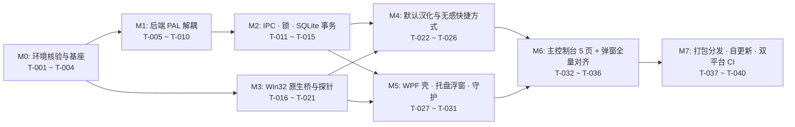

# GravityBox for Windows — SDD 执行计划与任务拆解文档（Execution Playbook）

> **文档编号**：`SDD-EXE-WIN-001`  
> **关联需求**：[`01-requirements.md`](./01-requirements.md)（`SDD-REQ-WIN-001`）  
> **关联设计**：[`02-design.md`](./02-design.md)（`SDD-DES-WIN-001`）  
> **适用模式**：Spec-Driven Development（SDD）—— 支持单人/多 Agent 并行推进，所有任务卡均具备原子边界、可验证命令与明确完成定义（DoD）。

---

## 1. SDD 开发工作流规程

### 1.1 单任务执行闭环（Mandatory 5-Step Loop）
每个 Task Card（`T-xxx`）必须严格按以下 5 步闭环交付，禁止跳步：
1. **Spec Lock（规格确认）**：阅读该任务关联的 `FR/NFR` 条目与 `02-design.md` 接口定义；若实机环境发现偏差，先更新规格文档再写代码。
2. **Contract Test First（契约测试先行）**：先在 `test/win/`、`test/` 或 `native-win/GravityBox.Tests/` 编写覆盖正向、边界与故障路径的失败测试。
3. **Minimal Implementation（最小完备实现）**：严格按涉及文件范围实现代码，禁止顺带重构无关模块；保持 `package.json` 零生产第三方依赖。
4. **Local Gate Verify（本地门禁验证）**：执行任务卡指定的 `npm run build` / `node --test` / `dotnet test` / `check-privacy`，确保 100% 绿灯。
5. **Traceability & Commit（可追溯提交）**：按 Conventional Commits 提交（例如 `feat(win-pal): implement win32 platform paths and ownership checks [T-005]`），并在本文件进度列或追踪看板标记完成。

### 1.2 分支与合并策略
- 建议从当前上游 `main` 切出长期特性分支 `feat/windows-port`，按里程碑拆分子分支 `feat/win-m0` ~ `feat/win-m7` 通过 PR 合入。
- 每个里程碑合入前，必须同时验证 **Windows 门禁** 与 **macOS 零回归门禁**（CI 矩阵双绿）。
- 隐私红线：每次提交前运行 `node tools/check-privacy.mjs`，严禁将本机用户名、绝对个人路径、真实邮箱或 OAuth 令牌提交进仓库。

---

## 2. 开发环境前置准备与 Day-0 实机核验手册

### 2.1 本地开发工具链清单
| 工具 | 最低版本要求 | 校验命令 |
| :--- | :--- | :--- |
| Windows OS | Windows 10 22H2 (19045+) 或 Windows 11 22H2+ (`x64`) | `[Environment]::OSVersion.Version` |
| Node.js | `>= 22.15.0 < 23`（强依赖 `node:sqlite`） | `node -v` |
| .NET SDK | `.NET 8.0 SDK`（含 Windows Desktop Targeting Pack） | `dotnet --list-sdks` |
| Git | `>= 2.40`（开启 `core.autocrlf = input` 防止污染 LF 行尾） | `git --version` |
| Inno Setup | `6.3+`（仅 M7 打包阶段必需，`iscc.exe`） | `iscc /?` |
| 官方 Antigravity | 官方正式版 Windows 安装包（用于 M0 核验与 M7 实机验收） | 安装目录存在 `Antigravity.exe` |

### 2.2 Day-0 实机核验表（M0 `T-001` 必做，结果须回填至 `02-design.md`）
在编码前，由开发者在安装了官方 Windows 版 Antigravity 的机器上执行以下只读核验（**严禁输出或记录任何凭据明文**）：

| 核验 ID | 核验目标 | 只读核验方式（PowerShell） | 产出并冻结的常量 |
| :--- | :--- | :--- | :--- |
| `CHK-01` | 安装路径、`app.asar` 与 `language_server` 路径 | 检查 `%LOCALAPPDATA%\Programs\Antigravity` 及 `%ProgramFiles%\Antigravity` 下的 `Antigravity.exe`、`resources\app.asar` 与 `resources\**\language_server*.exe` | `WIN_DEFAULT_APP_CANDIDATES`, `WIN_LS_REL_PATH`, `WIN_LS_EXE_REGEX` |
| `CHK-02` | Authenticode 证书主体 | `(Get-AuthenticodeSignature "<exe>").SignerCertificate.Subject` 与 `.Status` | `WIN_OFFICIAL_SIGNER_SUBJECT_RE` |
| `CHK-03` | 用户配置目录与 `state.vscdb` | 检查 `%APPDATA%\Antigravity\DevToolsActivePort`（启动带 `--remote-debugging-port=0` 后）及 `%APPDATA%\Antigravity\User\globalStorage\state.vscdb` 是否存在 | `WIN_DEFAULT_PROFILE_DIR` |
| `CHK-04` | `go-keyring` Windows 凭据条目名 | 运行 `cmdkey /list`（仅观察目标名，绝不读取密码），核对是否含 `gemini:antigravity` 或其他命名格式 | `WIN_CRED_TARGET_NAME`, `WIN_CRED_LEGACY_TARGETS` |
| `CHK-05` | 2.34+ CSRF 传递方式与 `main.js` 哈希 | 启动后运行只读验证脚本检查 `language_server` 命令行是否含 `--csrf_token` 或依赖 PEB `ANTIGRAVITY_SERVER_CSRF_TOKEN`；计算回环 `/main.js` 的 SHA-256 | 更新 `src/bundle.ts` 中 `SUPPORTED_BUNDLES` Windows 哈希 |

---

## 3. 里程碑路线图与依赖关系（M0 – M7）

### 里程碑概览与并行策略
| 里程碑 | 核心交付目标 | 关键里程碑验收标志（Exit Criteria） | 可并行工作流 |
| :--- | :--- | :--- | :--- |
| **M0** | Day-0 核验冻结、`tools/doctor` 与测试脚本跨平台化、`native-win` 解决方案初始化 | `npm run build`、`dotnet build` 与首批跨平台单测在 Windows 跑通 | 串行前置（1 天） |
| **M1** | `src/platform/` PAL 落地，消除全部硬编码路径、`uid` 与 POSIX 分隔符 | 核心纯逻辑测试在 Windows 全绿，macOS 回归 0 失败 | 与 M3 的 `GravityBox.Win32` 类库并行 |
| **M2** | Windows Named Pipe + `authToken` IPC、跨平台进程锁、`node:sqlite` 切号事务、缓存跨卷安全移动 | `ipc*`、`account-switch*`、`rollback-recovery`、`maintenance*` 全部测试在 Windows 通过 | 依赖 M1 |
| **M3** | `GravityBox.Win32` + `GravityBox.WinHelper` 全量实现并接入 `discovery`、`account-probe`、`account-keychain` | Windows 实机可自动发现官方 Antigravity、验真签名、读取实时配额与读写凭据 | 与 M1/M2 并行开发，M2 后联调 |
| **M4** | 开箱默认 `zh-Hans`、Windows 词典层 `dict/win32.json`、多平台指纹、快捷方式无感补参/还原、CDP Browser E2E | 英文 Windows 环境首启默认中文汉化 + HUD；`test/browser.mjs` 在 Windows 全绿；快捷方式增删还原幂等 | 依赖 M2 + M3 |
| **M5** | `.NET 8 WPF` 壳框架、Design Tokens 深浅色、托盘图标与 424 DIP 三标签浮窗、JobObject 后端守护、安全重启 | 托盘可启动守护 Node 后端、展示实时三标签浮窗、一键打开/安全重启 Antigravity 自动中文汉化 | 与 M4 后期并行 |
| **M6** | 5 页主控制台（Overview / Accounts / Usage / Settings / About）+ 6 个弹窗/窗口 + 自启/跟随启停 | 全功能 1:1 对齐 macOS v1.1.3，所有 xUnit ViewModel 契约测试全绿 | 依赖 M4 + M5（各页面可多 Agent 并行） |
| **M7** | Inno Setup + Portable 打包脚本、SHA-256 自更新器、双平台 GitHub Actions CI、洁净虚拟机与实机验收 | 产出可安装 `.exe` + `.zip` + `.sha256`；CI `macos-latest` 与 `windows-latest` 全绿；实机验收签收 | 依赖 M6 |

---

## 4. 原子级 SDD 任务清单（`T-001` – `T-040`）

---

### Milestone 0：环境核验与跨平台工程基座

#### `T-001` Day-0 Windows 宿主实机核验与常量冻结
- **关联需求 / 设计**：`CHK-01`–`CHK-05` / `02-design.md §2.2, §4.1.2, §4.5`
- **涉及文件**：`docs/sdd/02-design.md`（回填实测常量）
- **前置依赖**：无
- **实现规格**：按本文件 §2.2 执行 5 项只读核验，确认官方 Antigravity Windows 安装目录、主程序与 `language_server` 文件名、Authenticode 签名主体、`%APPDATA%\Antigravity` 结构、`go-keyring` Credential Manager TargetName、当前正式版 `main.js` SHA-256，并在 `02-design.md` 标注实测结果与核验版本号。
- **验证命令**：无代码变更，核验记录签字冻结。
- **DoD**：`CHK-01`–`CHK-05` 全部填妥具体实测值，无待定项。

#### `T-002` 开发环境检测与测试运行器跨平台适配
- **关联需求 / 设计**：`NFR-006`, `NFR-008` / `02-design.md §8`
- **涉及文件**：`tools/doctor.mjs`, `tools/run-tests.mjs`, `tools/clean-dist.mjs`, `tools/copy-runtime.mjs`, `tools/check-privacy.mjs`, `package.json`
- **前置依赖**：`T-001`
- **实现规格**：
  1. `tools/doctor.mjs` 按 `process.platform` 分支：macOS 检查 `xcrun swiftc`，Windows 检查 `dotnet --version`（`.NET 8+`）与 Node `>=22.15 <23`，不再因缺失 `/usr/bin/xcrun` 阻断 Windows 的 `npm run build`！
  2. `tools/run-tests.mjs` 自动跳过仅适用于 macOS 的 Swift 原生测试（`native-*.test.mjs`），在 Windows 上识别并执行 `test/win/*.test.mjs`。
  3. `tools/check-privacy.mjs` 增加 Windows 用户目录泄漏检测规则（拦截 `C:\Users\<non-placeholder>\`）。
  4. `package.json` 新增脚本：`build:win-native`、`test:win`、`test:win-native`、`verify:win`、`package:win`。
- **验证命令**：`npm ci && npm run build && node tools/doctor.mjs --skip-native && node tools/check-privacy.mjs`
- **DoD**：Windows 上 `npm run build` 0 报错完成；macOS 原有脚本行为不变。

#### `T-003` 初始化 `.NET 8` 解决方案骨架与多项目配置
- **关联需求 / 设计**：`FR-031`–`FR-036` / `02-design.md §4.8.1`
- **涉及文件**：`native-win/GravityBox.sln`, `native-win/Directory.Build.props`, `native-win/GravityBox.Win32/*.csproj`, `native-win/GravityBox.WinHelper/*.csproj`, `native-win/GravityBox.App/*.csproj`, `native-win/GravityBox.Tests/*.csproj`
- **前置依赖**：`T-002`
- **实现规格**：创建 4 项目 `.NET 8` 解决方案（开启 `<Nullable>enable</Nullable>`、`<TreatWarningsAsErrors>true</TreatWarningsAsErrors>`、`net8.0-windows10.0.19041.0`），配置 WPF Per-Monitor V2 DPI Manifest（`app.manifest`），引入 `CommunityToolkit.Mvvm` 与 `xUnit` / `Moq`（或手写轻量 Fake），配置 `GravityBox.WinHelper` 输出自动复制至后端开发可见路径。
- **验证命令**：`dotnet build native-win/GravityBox.sln -c Release && dotnet test native-win/GravityBox.sln -c Release`
- **DoD**：4 个项目编译 0 警告 0 错误，空壳单测通过。

#### `T-004` 跨平台测试隔离辅助工具与路径规范基线
- **关联需求 / 设计**：`NFR-008` / `02-design.md §8.1`
- **涉及文件**：`test/win/helpers.mjs`
- **前置依赖**：`T-002`
- **实现规格**：封装 Windows 测试临时沙箱生成器（支持含中文字符与空格目录名，如 `测试 用户/GravityBox 沙箱`）、Mock `PlatformAdapter` 工厂与 Mock `WinHelperClient` 工厂，供 M1–M4 所有契约测试复用。
- **验证命令**：`node --test test/win/*.test.mjs`
- **DoD**：沙箱辅助模块就绪并通过自检测试。

---

### Milestone 1：核心后端平台抽象层（PAL）与 POSIX 全量解耦

#### `T-005` 建立 `src/platform/` 抽象契约与路径/安全模块
- **关联需求 / 设计**：`NFR-004`, `NFR-006`, `NFR-008` / `02-design.md §4.1`
- **涉及文件**：`src/platform/types.ts`, `src/platform/paths.ts`, `src/platform/security.ts`, `src/platform/darwin.ts`, `src/platform/win32.ts`（首版骨架）, `src/platform/index.ts`, `test/win/platform-paths.test.mjs`
- **前置依赖**：`T-004`
- **实现规格**：
  1. 完整实现 `PlatformAdapter` 接口与 `getPlatform()` / `setPlatformForTests()`。
  2. `paths.ts` 实现 macOS 与 Windows 默认路径解析（遵循 `02-design.md §4.1.2`），自动兼容环境变量覆盖（`GRAVITYBOX_STATE_DIR`、`LOCALAPPDATA`、`APPDATA`、`USERPROFILE`）。
  3. `security.ts` 实现 `assertOwnedPath()`（macOS 沿用 `uid === process.getuid()`；Windows 校验 `isSymbolicLink()` + `WinHelper.acl_verify_owner` 拒绝非当前用户/ReparsePoint）、`isStrictSubpath()`（Windows 大小写归一化）、`sanitizeHostPaths()`（同时脱敏 POSIX 与 Windows `C:\Users\demo\...` 路径）。
  4. `darwin.ts` 无损迁入原有 macOS 命令实现。
- **验证命令**：`npm run build && node --test test/win/platform-paths.test.mjs`
- **DoD**：路径、子路径边界、路径脱敏与所有权校验在双平台语义完全一致且单测全绿。

#### `T-006` 重构 `src/files.ts` 消除 `process.getuid` 依赖并加固 Windows 原子写
- **关联需求 / 设计**：`NFR-005`, `NFR-008` / `02-design.md §3`
- **涉及文件**：`src/files.ts`, `test/win/files-atomic.test.mjs`
- **前置依赖**：`T-005`
- **实现规格**：
  1. 将 L17/L89/L122 的 `info.uid !== process.getuid?.()` 替换为 `platform.assertOwnedPath()`。
  2. `atomicText()` 的 `renameSync(temp, path)` 在 Windows 下包装有界退避重试（仅对 `EPERM`/`EBUSY`/`EACCES` 最多重试 5 次，间隔 10/20/40/80/120ms，应对防病毒实时扫描锁）。
  3. `basenameForLog()` 改为 `path.basename()`；`recoverAccountCommit()` 使用 `platform.isStrictSubpath()` 校验 `accountPath`。
- **验证命令**：`npm run build && node --test test/win/files-atomic.test.mjs test/storage-contracts.test.mjs`
- **DoD**：含中文/空格路径原子读写、事务日志恢复及并发模拟重试测试全绿。

#### `T-007` 重构 `src/application-target.ts`、`src/bundle-cache.ts`、`src/coverage.ts` 与 `src/pricing-catalog-runtime.ts`
- **关联需求 / 设计**：`FR-002`, `FR-007`, `FR-008`, `FR-025` / `02-design.md §3, §4.1`
- **涉及文件**：`src/application-target.ts`, `src/bundle-cache.ts`, `src/coverage.ts`, `src/pricing-catalog-runtime.ts`, `test/application-channel.test.mjs`, `test/win/app-target-win.test.mjs`
- **前置依赖**：`T-005`
- **实现规格**：
  1. `application-target.ts` 全部通过 `platform.resolveAppLayout(appPath)` 读取 `asarPath`、`defaultAntigravityProfile`、`detectInstalledChannels()` 与 `matchingTargetForLanguageServerCommand()`（兼容 Windows 反斜杠与 `.exe` 扩展名、大小写不敏感匹配、排除 Insiders 路径）。
  2. `bundle-cache.ts` 读取 `layout.asarPath`、`layout.asarUnpackedPath` 与 `language_server`（不再硬编码 `Contents/Resources`）。
  3. `coverage.ts` `nativeSources()` 使用 `layout.asarPath`。
  4. `pricing-catalog-runtime.ts` `readInstalledAppBundleVersion()` 委托 `platform.readAppVersionFast(appPath)`，并替换 L190 的 `uid` 校验。
- **验证命令**：`npm run build && node --test test/application-channel.test.mjs test/coverage.test.mjs test/pricing-catalog-sync.test.mjs test/win/app-target-win.test.mjs`
- **DoD**：全量既有相关测试 + Windows 布局测试全绿。

#### `T-008` 重构 `src/usage.ts` 与 `src/usage-ledger-worker.ts` 路径与所有权校验
- **关联需求 / 设计**：`FR-023`–`FR-026` / `02-design.md §3`
- **涉及文件**：`src/usage.ts`, `src/usage-ledger-worker.ts`, `src/usage-revalue.ts`
- **前置依赖**：`T-005`, `T-006`
- **实现规格**：
  1. 替换 `usage.ts` 中硬编码的 `Library/Application Support/GravityBox` 与 `Library/Caches/GravityBox` 为 `platform.getDefaultPaths()`。
  2. 替换 `usage-ledger-worker.ts` L39/L258 的 `stat.uid !== process.getuid?.()` 为同步跨平台所有权/非符号链接检查（不触发 Windows `0 !== undefined` 误判）。
  3. `usage-revalue.ts` 中 `chmodSync` 在 Windows 下安全容错并调用目录 ACL 保护。
- **验证命令**：`npm run build && node --test test/usage-contracts.test.mjs test/usage-ledger.test.mjs test/usage-ledger-fixes.test.mjs test/phase4-usage-charts.test.mjs test/pricing-contracts.test.mjs`
- **DoD**：全部用量、总账与计价测试在 Windows 上 100% 通过。

#### `T-009` 重构 `src/accounts.ts` 路径、进程探针与导出安全检查
- **关联需求 / 设计**：`FR-013`–`FR-019` / `02-design.md §3`
- **涉及文件**：`src/accounts.ts`, `src/account-probe.ts`, `src/account-keychain.ts`
- **前置依赖**：`T-005`, `T-006`, `T-007`
- **实现规格**：
  1. 替换 `accounts.ts` 中所有 `Library/Application Support`、`process.getuid?.()`、`/bin/ps` 与 `this.accountsDir + '/'` 前缀判断为 PAL 调用。
  2. `account-probe.ts` 将 `/bin/ps`、`ps -E`、`/usr/sbin/lsof` 与 `/Contents/Resources/bin/language_server` 抽象委托给 `platform` 方法（保留 `execFileImpl` 测试钩子兼容既有 macOS 单测）。
  3. `account-keychain.ts` 按 `platform.createKeychainAdapter()` 分发默认适配器。
- **验证命令**：`npm run build && node --test test/accounts-contracts.test.mjs test/account-lifecycle.test.mjs test/account-save-current.test.mjs test/account-oauth.test.mjs test/account-probe.test.mjs test/quota-contracts.test.mjs test/quota-system.test.mjs`
- **DoD**：全部账号与配额核心单测在 Windows 上 100% 通过。

#### `T-010` 重构 `src/maintenance*.ts` 跨平台适配与跨卷安全移动
- **关联需求 / 设计**：`FR-027`–`FR-030` / `02-design.md §4.7`
- **涉及文件**：`src/maintenance.ts`, `src/maintenance-catalog.ts`, `src/maintenance-discovery.ts`, `src/maintenance-journal.ts`, `test/win/maintenance-win.test.mjs`
- **前置依赖**：`T-005`, `T-006`
- **实现规格**：
  1. `maintenance.ts` 默认保险库取 `platform.getDefaultPaths().defaultTrashDir`；移除硬编码 `~/.Trash` 与 `Library/Caches`。
  2. `maintenance-catalog.ts` `readProcessCommands()` / `hasAntigravityCommand()` / `hasBrowserProfileCommand()` 通过 `platform.listProcesses()` 实现（Windows 大小写不敏感匹配 `<appRoot>\` 与 `browser_profile` 命令行）。
  3. `maintenance-journal.ts` 移除 `stat.uid !== process.getuid?.()`；增加 `EXDEV` 跨卷安全移动（copy→verify→rename→rm）与 `EBUSY`/`EPERM` 文件锁占用检测及自动回滚。
  4. `isStrictSubpath()` 委托 `platform.isStrictSubpath()`。
- **验证命令**：`npm run build && node --test test/maintenance-contracts.test.mjs test/maintenance-journal.test.mjs test/maintenance-v2.test.mjs test/win/maintenance-win.test.mjs`
- **DoD**：既有 3 套维护测试 + Windows 跨卷/文件锁/ReparsePoint 测试全绿。

---

### Milestone 2：Named Pipe IPC、进程锁与零外部依赖 SQLite 切号事务

#### `T-011` 重构 `src/process-lock.ts` 实现跨平台独占租约锁
- **关联需求 / 设计**：`NFR-005` / `02-design.md §1 ADR-008, §3`
- **涉及文件**：`src/process-lock.ts`, `test/win/process-lock-win.test.mjs`
- **前置依赖**：`T-005`
- **实现规格**：
  1. 采用 `open(path, 'wx', 0o600)` 独占创建写入 `{ pid, nonce, createdAt }`（Windows 不依赖硬链接 `link()`），写入完成后同步关闭。
  2. 死锁回收：通过 `platform.isProcessAlive(pid, createdAt)` 校验原持有者已死（规避 Windows PID 复用与 `lsof` 依赖），采用原 `.reclaim` 协议安全回收。
  3. 替换 `info.uid !== process.getuid?.()` 为 `platform.assertOwnedPath()`。
- **验证命令**：`npm run build && node --test test/win/process-lock-win.test.mjs test/accounts-race.test.mjs`
- **DoD**：多进程并发争抢、死进程自动回收、同进程重入全部通过。

#### `T-012` 实现 `src/account-db-tx.ts`（`node:sqlite` 零依赖切号事务）并重构 `src/account-switch.ts`
- **关联需求 / 设计**：`FR-020`, `FR-021`, `FR-022`, `NFR-003` / `02-design.md §1 ADR-004, §4.6`
- **涉及文件**：`src/account-db-tx.ts`, `src/account-switch.ts`, `test/win/account-db-tx.test.mjs`
- **前置依赖**：`T-006`, `T-009`, `T-011`
- **实现规格**：
  1. 以 `DatabaseSync` (`node:sqlite`) 实现 `DatabaseTransaction`，采用参数化预编译 SQL 与 `BEGIN IMMEDIATE` / `COMMIT` / `ROLLBACK`，彻底移除 `/usr/bin/sqlite3` 子进程依赖。
  2. 修复 `account-switch.ts` 中 `isNonSensitiveIndexFile()`、`reconcileRollback()` 的 `/` 路径分隔符硬编码及 `guardStopped()` 的 `/bin/ps` 依赖。
  3. 保持 `databaseFactory` 注入钩子兼容既有故障注入单测。
- **验证命令**：`npm run build && node --test test/win/account-db-tx.test.mjs test/account-switch-security.test.mjs test/rollback-recovery.test.mjs`
- **DoD**：在 Windows 无 `sqlite3.exe` 环境下完整跑通四阶段切号、故障注入回滚与崩溃对账测试。

#### `T-013` 实现 Windows Named Pipe IPC 服务端/客户端与 `authToken` 鉴权
- **关联需求 / 设计**：`NFR-004` / `02-design.md §4.3`
- **涉及文件**：`src/platform/win32.ts`, `src/platform/darwin.ts`, `src/main.ts`, `test/win/ipc-named-pipe.test.mjs`
- **前置依赖**：`T-005`, `T-011`
- **实现规格**：
  1. `win32.ts` 实现 `getIpcEndpoint(stateDir)`（`\\.\pipe\gravitybox-<hash>`）、`createIpcServer()`、`ipc.token` 生成与当前用户 ACL 加固。
  2. `main.ts` 抽象 socket/pipe 启动、存活探测、`request()` CLI 客户端与优雅退出清理（不再对 Named Pipe 执行 `lstat`/`chmod`/`unlink`）。
  3. Windows 服务端对除单元测试显式关闭外的 IPC 请求校验 `authToken`（`timingSafeEqual`）；`request()` CLI 自动读取 `stateDir/ipc.token` 并附带。
- **验证命令**：`npm run build && node --test test/win/ipc-named-pipe.test.mjs test/ipc.test.mjs test/ipc-contracts.test.mjs test/ipc-hardening.test.mjs`
- **DoD**：Named Pipe 并发读写、4MB 载荷上限、跨 chunk 多字节中文 UTF-8、`authToken` 伪造拒绝、单实例冲突拦截全绿。

#### `T-014` 适配 `src/main.ts` 切号预检、错误脱敏与 Windows 扩展 IPC 路由
- **关联需求 / 设计**：`FR-003`, `FR-020`, `FR-037` / `02-design.md §5.2`
- **涉及文件**：`src/main.ts`, `test/audit-p4-main-errors.test.mjs`
- **前置依赖**：`T-012`, `T-013`
- **实现规格**：
  1. 重写 `account_switch_preflight` 改用 `platform.listProcesses()` 与 `platform.isInsidersPath()` 检测官方与 Insiders 运行态及 `language_server` CPU。
  2. 扩展 `sanitizeErrorMessage()` 调用 `platform.sanitizeHostPaths()`，确保不泄露 `C:\Users\demo\...` 等本机路径。
  3. 注册 `platform_info`、`shortcut_scan`、`shortcut_apply`、`shortcut_restore` 4 个新命令（在 macOS 上优雅降级返回不支持/空集合）。
- **验证命令**：`npm run build && node --test test/audit-p4-main-errors.test.mjs test/audit-sanitize.test.mjs`
- **DoD**：预检与新命令契约测试全绿，所有错误消息均脱敏。

#### `T-015` 复核 `src/hud/` 与 `src/sqlite-*.ts` 在 Windows 下的只读并发与路径处理
- **关联需求 / 设计**：`FR-009`–`FR-012` / `02-design.md §2.1`
- **涉及文件**：`src/hud/metrics-engine.ts`, `src/hud/hud-bridge.ts`, `src/sqlite-read.ts`, `src/sqlite-worker.ts`
- **前置依赖**：`T-005`
- **实现规格**：检查并验证 `metrics-engine.ts`、`hud-bridge.ts`、`sqlite-worker.ts` 在 Windows 路径（含中文用户名与 `\` 分隔符）下的只读 WAL 读取与 `ArrayBuffer` 转移；补齐 Windows 并发写/读压力测试。
- **验证命令**：`npm run build && node --test test/hud-contracts.test.mjs test/hud-bridge.test.mjs test/hud-precision.test.mjs test/hud-oversized-step.test.mjs test/hud-instance-lifecycle.test.mjs test/hud-takeover.test.mjs`
- **DoD**：全部 HUD 契约与精度测试在 Windows 上 100% 通过。

---

### Milestone 3：Windows 原生系统桥（`GravityBox.Win32` + `WinHelper`）与实机探针

#### `T-016` 实现 `GravityBox.Win32` 进程、网络端口与 PEB 环境变量读取模块
- **关联需求 / 设计**：`FR-002`, `FR-004`, `FR-013`, `FR-020` / `02-design.md §4.2.2, §4.5`
- **涉及文件**：`native-win/GravityBox.Win32/ProcessInspector.cs`, `NetworkInspector.cs`, `WindowCloser.cs`, `JobObjectGuard.cs`, `native-win/GravityBox.Tests/Win32Tests/ProcessAndNetworkTests.cs`
- **前置依赖**：`T-003`
- **实现规格**：
  1. `ProcessInspector`：基于 `CreateToolhelp32Snapshot` + `QueryFullProcessImageNameW` + 64 位 PEB `ReadProcessMemory` 获取进程全路径、命令行、启动时间与指定单个环境变量（`ANTIGRAVITY_SERVER_CSRF_TOKEN`），对无权访问进程静默跳过不抛异常。
  2. `NetworkInspector`：基于 `GetExtendedTcpTable`（IPv4 + IPv6）精确返回按端口或按 PID 过滤的 `LISTEN` 条目及进程可执行路径。
  3. `WindowCloser`：枚举指定可执行路径进程顶层窗口并发送 `WM_CLOSE`。
  4. `JobObjectGuard`：创建 `JOB_OBJECT_LIMIT_KILL_ON_JOB_CLOSE` Job Object 封装 `AssignProcess`。
- **验证命令**：`dotnet test native-win/GravityBox.sln --filter "Category=Win32ProcessNetwork"`
- **DoD**：可精准读取自启测试子进程的命令行、自定义测试环境变量、本机随机回环监听端口，且父进程释放 JobObject 后子进程自动终止。

#### `T-017` 实现 `GravityBox.Win32` Authenticode 验真、Windows Credential Manager 与 NTFS ACL 模块
- **关联需求 / 设计**：`FR-002`, `FR-017`, `FR-021`, `NFR-004` / `02-design.md §4.2.2, §4.5.1, §4.6.2`
- **涉及文件**：`native-win/GravityBox.Win32/AuthenticodeVerifier.cs`, `CredentialStore.cs`, `SecurityAclHelper.cs`, `RecycleBinHelper.cs`, `native-win/GravityBox.Tests/Win32Tests/SecurityAndCredTests.cs`
- **前置依赖**：`T-003`, `T-001`
- **实现规格**：
  1. `AuthenticodeVerifier`：调用 `WinVerifyTrust` 验证签名有效性，返回 `Subject`/`Issuer`/`Thumbprint`/`FileVersion`/`ProductName`。
  2. `CredentialStore`：封装 `CredReadW`/`CredWriteW`/`CredDeleteW`（支持 UTF-8 `go-keyring-base64:` 读写及 2560 字节上限保护）。
  3. `SecurityAclHelper`：封装文件/目录仅当前用户 SID + `SYSTEM` ACL 加固及 `ReparsePoint` + 所有者校验。
  4. `RecycleBinHelper`：封装 Shell `IFileOperation` 移入回收站。
- **验证命令**：`dotnet test native-win/GravityBox.sln --filter "Category=Win32SecurityCred"`
- **DoD**：系统已签名二进制（如 `notepad.exe`）验真通过、未签名临时文件验真拒绝；测试前缀凭据读写删幂等；目录 ACL 仅含当前用户与 SYSTEM。

#### `T-018` 实现 `GravityBox.Win32` 快捷方式（COM `IShellLinkW`）与系统语言探测模块
- **关联需求 / 设计**：`FR-001`, `FR-003` / `02-design.md §4.2.2, §4.4.4`
- **涉及文件**：`native-win/GravityBox.Win32/ShortcutManager.cs`, `SystemLocaleHelper.cs`, `native-win/GravityBox.Tests/Win32Tests/ShortcutTests.cs`
- **前置依赖**：`T-003`
- **实现规格**：
  1. `ShortcutManager`：扫描 `FOLDERID_Desktop`、`FOLDERID_Programs`、`User Pinned\TaskBar` 中的 `.lnk`，通过 COM `IShellLinkW` / `IPersistFile` 解析真实目标与 `Arguments`，提供安全写入 `Arguments` 接口。
  2. `SystemLocaleHelper`：调用 `GetUserPreferredUILanguages(MUI_LANGUAGE_NAME)` 返回 BCP-47 首选语言数组。
- **验证命令**：`dotnet test native-win/GravityBox.sln --filter "Category=Win32Shortcut"`
- **DoD**：对临时测试 `.lnk` 可准确解析/更新中文路径与参数且不破坏图标和工作目录。

#### `T-019` 实现 `GravityBox.WinHelper` stdio JSON-RPC 服务与 Node 侧 `WinHelperClient`
- **关联需求 / 设计**：`NFR-001`, `NFR-004` / `02-design.md §4.2`
- **涉及文件**：`native-win/GravityBox.WinHelper/Program.cs`, `src/platform/win-helper-client.ts`, `test/win/win-helper-client.test.mjs`
- **前置依赖**：`T-016`, `T-017`, `T-018`
- **实现规格**：
  1. `GravityBox.WinHelper` 按行读取 `stdin` JSON `{ id, method, params }` 并分发至 `GravityBox.Win32`，单行 JSON 写回 `stdout`，日志禁止写 `stdout`，异常脱敏返回 `{ id, ok: false, error }`；父进程关闭 `stdin` 时优雅退出。
  2. `WinHelperClient` 实现按需拉起、请求并发关联（按 `id`）、超时保护、崩溃自动重建、空闲 60s 自动回收。
- **验证命令**：`dotnet build native-win/GravityBox.sln -c Release && npm run build && node --test test/win/win-helper-client.test.mjs`
- **DoD**：单次 RPC 往返延迟 < 10ms（暖进程），异常断开自动重建，无残留僵尸进程。

#### `T-020` 完成 `src/platform/win32.ts` 全量对接并重构 `src/discovery.ts`
- **关联需求 / 设计**：`FR-002`, `FR-007`, `FR-013` / `02-design.md §4.5`
- **涉及文件**：`src/platform/win32.ts`, `src/discovery.ts`, `test/win/discovery-win.test.mjs`
- **前置依赖**：`T-019`
- **实现规格**：
  1. 将 `src/platform/win32.ts` 所有方法接入 `WinHelperClient`（含 `verifyOfficialApp`、`findTcpListenersByPort`、`findTcpListenersByPid`、`listProcesses`、`readProcessEnvVar`、`createKeychainAdapter`、`assertOwnedPath`）。
  2. 重构 `src/discovery.ts` 移除 `/usr/sbin/lsof`、`/usr/bin/codesign`、`/usr/libexec/PlistBuddy`、`/bin/ps` 硬编码，统一通过 `platform` 调用；磁盘校验缓存改用 `platform.getDefaultPaths().cacheDir` 并兼容 Windows `(exeStat, asarStat)` 指纹字段。
- **验证命令**：`npm run build && node --test test/win/discovery-win.test.mjs test/core.test.mjs`
- **DoD**：Mock 与本机端到端测试覆盖非回环拦截、非官方签名拦截、旧版补丁检测、缓存命中与失效。

#### `T-021` 实机联调验证 Windows `discovery`、`account-probe` 与 `Win32CredentialAdapter`
- **关联需求 / 设计**：`FR-013`, `FR-017`, `FR-021` / `02-design.md §4.5, §4.6.2`
- **涉及文件**：`tools/win/smoke-probe-win.mjs`（只读联调脚本，脱敏输出）
- **前置依赖**：`T-020`
- **实现规格**：编写只读冒烟脚本，在安装了官方 Antigravity 的 Windows 机器上实测：① `detectInstalledChannels()` 命中官方目录；② `inspectBundle()` 通过 Google Authenticode 验真并读出正确版本号；③ 启动带 `--remote-debugging-port=0` 的 Antigravity 后 `discover()` 返回回环 CDP 端点；④ `probeLiveLanguageServerOnce()` 返回脱敏的实时订阅等级与配额结构。
- **验证命令**：`node tools/win/smoke-probe-win.mjs`
- **DoD**：4 项实机探针全部返回 `PASS`，并将实测 Windows `main.js` SHA-256 补充登记至 `src/bundle.ts`。

---

### Milestone 4：默认简体中文汉化、Windows 词条增强与无感快捷方式管理

#### `T-022` 实施开箱默认简体中文策略（`FR-001`）
- **关联需求 / 设计**：`FR-001`, `FR-012` / `02-design.md §4.4.1`
- **涉及文件**：`src/i18n.ts`, `src/main.ts`, `assets/i18n/zh-Hans.json`, `assets/i18n/en.json`, `test/i18n-foundation.test.mjs`, `test/win/default-zh-hans.test.mjs`
- **前置依赖**：`T-013`, `T-019`
- **实现规格**：
  1. `src/i18n.ts` 支持 `detectSystemLocales()` 读取 Windows 首选语言；`resolveInitialRuntimeLanguage()` 支持 `defaultFreshLanguage` 策略参数（不破坏原单测对显式 `system` 的断言）。
  2. `src/main.ts` 全新安装无配置时默认 `configuredLanguage = 'zh-Hans'`、`resolvedLocale = 'zh-Hans'`、`translationEnabled = true`、`hudEnabled = true`（即使 `--system-locales en-US` 亦保持首次默认简体中文，直至用户显式切换为 `en` 或 `system`）。
  3. 在 `assets/i18n/zh-Hans.json` 与 `en.json` 中补齐 Windows 专属 UI 文案键（`about.reveal_data_win`「在文件资源管理器中显示」、`settings.login.subtitle_win`「登录 Windows 时自动在系统托盘驻留」、无感快捷方式引导与管理文案等）。
- **验证命令**：`npm run build && node --test test/i18n-foundation.test.mjs test/win/default-zh-hans.test.mjs`
- **DoD**：在模拟 `en-US` 系统语言全新目录下启动后端，`status` 返回 `locale: "zh-Hans"`, `translationEnabled: true`；切换 `en` / `system` / `zh-Hans` 全链路通过。

#### `T-023` 新增 `dict/win32.json` 平台词典层与多平台 Bundle 指纹支持
- **关联需求 / 设计**：`FR-005`, `FR-006` / `02-design.md §4.4.2, §4.4.3`
- **涉及文件**：`dict/win32.json`, `src/dictionary.ts`, `src/bundle.ts`, `src/controller.ts`, `test/dictionary-contracts.test.mjs`, `test/win/dict-win32.test.mjs`
- **前置依赖**：`T-021`, `T-022`
- **实现规格**：
  1. 创建 `dict/win32.json`（遵守 `PROPER_NOUNS`、`GLOSSARY_RULES` 与占位符一致性门禁，补充 Windows 菜单/窗口/资源管理器/快捷键相关界面文案）。
  2. `dictionary.ts` `layerRank()` 与 `loadDictionaryLayers()` 支持仅在 `process.platform === 'win32'`（或显式传入 `platform: 'win32'`）时在 `base.json` 之上合并 `win32.json`。
  3. `bundle.ts` 扩展 `SUPPORTED_BUNDLES` 支持多哈希数组，并登记实测 Windows 官方 `main.js` SHA-256；`controller.ts` `verifiedBundle()` 调用 `isVerifiedBundleHash()`。
  4. `controller.ts` 确认自适应全量汉化升级路径在未收录版本下自动生效且生成 `pending-<version>.json`。
- **验证命令**：`npm run build && node --test test/dictionary-contracts.test.mjs test/release-dictionary-hygiene.test.mjs test/audit-p2-dictionary.test.mjs test/win/dict-win32.test.mjs`
- **DoD**：Windows 词典加载顺序正确、所有词典卫生/术语门禁 0 违规、macOS 词典哈希不受影响。

#### `T-024` 实现 Windows 无感启动汉化快捷方式服务（`src/platform/shortcuts.ts`）
- **关联需求 / 设计**：`FR-003` / `02-design.md §4.4.4, §5.2`
- **涉及文件**：`src/platform/shortcuts.ts`, `src/main.ts`, `test/win/shortcuts-service.test.mjs`
- **前置依赖**：`T-014`, `T-019`
- **实现规格**：
  1. 实现 `scanShortcuts()`、`applyShortcutDebugPort()`、`restoreShortcutDebugPort()`，持久化备份至 `stateDir/shortcut-backups.json`（使用 `atomicJson` + 进程锁）。
  2. 严格仅处理指向已验真官方 `Antigravity.exe` 的 `.lnk`；已有 `--remote-debugging-port` 时幂等跳过；还原时智能保留用户后续手动添加的其他参数。
  3. 将 3 个服务接入 `main.ts` 的 `shortcut_scan`、`shortcut_apply`、`shortcut_restore` 命令。
- **验证命令**：`npm run build && node --test test/win/shortcuts-service.test.mjs`
- **DoD**：覆盖空参数、已有自定义参数、重复应用幂等、用户后续加参后还原、非官方/Insiders `.lnk` 拒改 5 类场景。

#### `T-025` 微调 `runtime/` 样式与兼容性确保 Windows IDE 渲染精致
- **关联需求 / 设计**：`FR-002`, `FR-009`, `FR-010` / `02-design.md §4.8.4`
- **涉及文件**：`runtime/hud-styles.js`, `runtime/engine.js`（仅必要兼容微调）
- **前置依赖**：`T-023`
- **实现规格**：优化 `hud-styles.js` 字体栈适配 Windows 10/11（`Segoe UI Variable` / `Microsoft YaHei UI` / `Cascadia Mono`）；检查 `engine.js` 中对 Windows 菜单项与快捷键字符（`Ctrl` / `Alt`）的保护规则，确保无误译、无排版溢出。
- **验证命令**：`npm run build && node --test test/hud-dom-adversarial-v2.test.mjs test/hud-audit-remediation-111.test.mjs`
- **DoD**：HUD 与 DOM 对抗测试全绿。

#### `T-026` 在 Windows 上跑通 Headless Chromium CDP E2E 回归测试
- **关联需求 / 设计**：`FR-002`, `FR-009`, `NFR-006` / `02-design.md §8.1`
- **涉及文件**：`tools/win/setup-test-browser-win.mjs`, `tools/setup-test-browser.mjs`, `test/browser.mjs`
- **前置依赖**：`T-022`, `T-023`, `T-025`
- **实现规格**：扩展 `setup-test-browser.mjs` 支持 `win32`（优先下载固定 Chrome for Testing `win64` 或读取 `CHROME_BIN` 指向系统 Edge/Chrome）；修复 `test/browser.mjs` 中任何 POSIX 路径/信号假设，完整执行无头浏览器隔离世界翻译、内容保护与 HUD 交互回归。
- **验证命令**：`npm run build && node tools/setup-test-browser.mjs && node test/browser.mjs`
- **DoD**：`test/browser.mjs` 在 Windows 上 100% 通过。

---

### Milestone 5：`.NET 8 WPF` 原生壳骨架、托盘浮窗与后端守护

#### `T-027` 实现 WPF 核心服务层（`BackendBridge`、`ConfigurationStore`、`L10nService`、`ThemeService`）
- **关联需求 / 设计**：`FR-001`, `FR-031`, `FR-033`, `NFR-001`, `NFR-007` / `02-design.md §4.3.3, §4.8.1`
- **涉及文件**：`native-win/GravityBox.App/Core/*.cs`, `native-win/GravityBox.Tests/CoreTests/*.cs`
- **前置依赖**：`T-003`, `T-013`, `T-016`, `T-022`
- **实现规格**：
  1. `BackendBridge`：启动内置 `runtime\node.exe`（`--max-old-space-size=256 core\dist\main.js --state-dir ... --locale ... --system-locales ...`），绑定 `JobObjectGuard`，实现 `backend.log` 1MB 自动轮转（留 10 份），实现读并发(8)/写串行(1) Named Pipe 客户端、12 次启动退避重试与 `authToken` 注入。
  2. `ConfigurationStore`：原子读写 `config.json` v2，首次创建默认 `AppLanguage = "zh-Hans"`、`HudEnabled = true`，保存时保留未知外部字段。
  3. `L10nService`：加载 `assets/i18n/*.json`，默认 `zh-Hans`，实现回退链、`{param}` 插值与语言变更事件通知。
  4. `ThemeService`：监听 `HKCU\Software\Microsoft\Windows\CurrentVersion\Themes\Personalize\AppsUseLightTheme` 热切 `DesignTokens.Light/Dark.xaml` 与 DWM 暗色标题栏 (`DWMWA_USE_IMMUTABLE_DARK_MODE`)。
- **验证命令**：`dotnet test native-win/GravityBox.sln --filter "Category=CoreServices"`
- **DoD**：单测覆盖首启默认中文、配置保留合并、Named Pipe 重试超时、JobObject 退出清理、深浅色切换。

#### `T-028` 实现 Fluent/Mica Design Tokens 与自定义基础控件库
- **关联需求 / 设计**：`FR-031`, `FR-032`, `NFR-007` / `02-design.md §4.8.2`
- **涉及文件**：`native-win/GravityBox.App/Theme/*.xaml`, `native-win/GravityBox.App/Controls/*.cs,*.xaml`
- **前置依赖**：`T-027`
- **实现规格**：
  1. 编写 `DesignTokens.Light.xaml`、`DesignTokens.Dark.xaml`（严格对齐 `02-design.md §4.8.2` 色值与圆角）及 `Controls.xaml`（圆角卡片、胶囊徽章 `PillBadge`、`TierBadge`、开关 `DesignSwitch`、分段控 `SegmentedTabs`、无干扰滚动条）。
  2. 实现原生高性能矢量图表控件：`UsageTrendChart`（24h/按日平滑折线+悬停提示）、`ModelDonutChart`（环图+图例）、`QuotaMeterRow`（双周期剩余进度条+倒计时）、`CacheCompositionBar`（三段占比条）。
- **验证命令**：`dotnet build native-win/GravityBox.sln -c Release`
- **DoD**：控件资源字典在深浅色下均能零异常加载与渲染，数字全部使用 `TabularFigures` 对齐。

#### `T-029` 实现系统托盘图标与无边框三标签快捷浮窗（`TrayFlyoutWindow`）
- **关联需求 / 设计**：`FR-031`, `FR-004` / `02-design.md §4.8.3`
- **涉及文件**：`native-win/GravityBox.App/Views/TrayFlyoutWindow.xaml(.cs)`, `ViewModels/TrayFlyoutViewModel.cs`, `Services/TrayIconService.cs`, `native-win/GravityBox.Tests/ViewModelTests/TrayFlyoutTests.cs`
- **前置依赖**：`T-027`, `T-028`
- **实现规格**：
  1. 单实例互斥启动（支持 `--minimized` 静默驻留托盘）；托盘图标随连接态变化，右键展示原生菜单（打开主界面、打开 Antigravity、显示语言、退出）。
  2. 左键唤起 `424 DIP` 宽无边框圆角浮窗：完整复刻 **用量 / 配额 / 账号** 三标签、`Ctrl+1/2/3` 快捷键、顶部刷新与 `···` 菜单、未开启调试端口横幅、底部「打开 Antigravity」与「打开主界面」；实现 §4.8.3 多屏高 DPI 任务栏贴靠与失焦自动收起。
- **验证命令**：`dotnet test native-win/GravityBox.sln --filter "Category=TrayFlyout"`
- **DoD**：ViewModel 契约测试全绿；人工实机核验 100%/150% DPI 与四向任务栏定位不漂移不裁切。

#### `T-030` 实现 Antigravity 启动、安全重启接管与生命周期联动服务
- **关联需求 / 设计**：`FR-004`, `FR-034` / `02-design.md §4.4.4`
- **涉及文件**：`native-win/GravityBox.App/Core/LifecycleSyncService.cs`, `native-win/GravityBox.Tests/CoreTests/LifecycleSyncTests.cs`
- **前置依赖**：`T-016`, `T-027`
- **实现规格**：
  1. `OpenAntigravityAsync()`：未运行时直接以 `--remote-debugging-port=0` 拉起官方 `Antigravity.exe`；已运行但无调试端口时触发 `SafeRelaunchAsync()`。
  2. `SafeRelaunchAsync()`：激活 30s 自动退出抑制期 → `WindowCloser.CloseGracefully()` 发送 `WM_CLOSE` → 轮询等待最多 10 秒（绝不强杀）→ 退出后等 300ms 重试最多 3 次拉起并校验 `DevToolsActivePort` 就绪。
  3. `QuitAntigravityAndWaitAsync()`（供切号与缓存清理复用）：优雅关闭含子进程并等待最多 20 秒。
  4. 开机自启（`HKCU\Software\Microsoft\Windows\CurrentVersion\Run`）与「跟随 Antigravity 启停」监控（进程退出 600ms 二次确认后自动停后端并退出）。
- **验证命令**：`dotnet test native-win/GravityBox.sln --filter "Category=LifecycleSync"`
- **DoD**：覆盖超时不强杀、重试拉起成功、切号抑制期不误退、注册表读写免 UAC 全部单测。

#### `T-031` 实现主控制台窗口框架（`MainWindow` + 左侧导航栏 + 全局状态栏）
- **关联需求 / 设计**：`FR-032` / `02-design.md §4.8.1`
- **涉及文件**：`native-win/GravityBox.App/Views/MainWindow.xaml(.cs)`, `ViewModels/MainShellViewModel.cs`
- **前置依赖**：`T-028`, `T-029`, `T-030`
- **实现规格**：左侧导航栏（总览 / 账号 / 用量 / 设置 / 关于 + 底部「打开 Antigravity」按钮 + 服务连接状态脚注 + 更新角标）、右侧页面宿主与顶部非阻断消息提示条；点击关闭按钮默认隐藏至托盘；3 秒定时轻量轮询 `status`（`includeTasks` 按 `taskRevision` 增量）。
- **验证命令**：`dotnet build native-win/GravityBox.sln -c Release`
- **DoD**：主窗口可在托盘与任务栏间平滑切换，状态同步与页面切换零闪烁。

---

### Milestone 6：主控制台 5 页与弹窗全功能对齐（可按页面并行开发）

#### `T-032` 总览页（`OverviewPage` + 无感快捷方式引导卡）
- **关联需求 / 设计**：`FR-003`, `FR-004`, `FR-013`, `FR-014`, `FR-032` / `02-design.md §4.8.1`
- **涉及文件**：`Views/Pages/OverviewPage.xaml(.cs)`, `ViewModels/OverviewViewModel.cs`, `GravityBox.Tests/ViewModelTests/OverviewTests.cs`
- **前置依赖**：`T-024`, `T-031`
- **实现规格**：
  1. 对齐 `native/Pages.swift`：未开启调试端口横幅、无感启动汉化首次引导卡（扫描到未配置 `.lnk` 且未关闭引导时展示「一键开启无感汉化」与「暂不提醒」）、当前账号 Hero 卡（名称/邮箱/套餐徽章/状态警示/刷新按钮 + 核心 5h/每周 + 独立高阶池配额条）、今日 3 指标磁贴、Bento 双栏看板（24h 消耗折线图 + 今日活跃模型速览）。
  2. 15 秒指纹节流，避免 3 秒 tick 重复重绘图表。
- **验证命令**：`dotnet test native-win/GravityBox.sln --filter "Category=Overview"`
- **DoD**：所有数据状态（加载中 / 未存实时账号 / 正常已存账号 / 局部错误降级 / 调试端口缺失）单测与渲染通过。

#### `T-033` 账号页与弹窗（`AccountsPage` + `AddAccountDialog` + `AccountPolicyDialog`）
- **关联需求 / 设计**：`FR-015`–`FR-022`, `FR-032` / `02-design.md §4.8.1`
- **涉及文件**：`Views/Pages/AccountsPage.xaml(.cs)`, `Views/Dialogs/AddAccountDialog.xaml(.cs)`, `Views/Dialogs/AccountPolicyDialog.xaml(.cs)`, `ViewModels/AccountsViewModel.cs`, `GravityBox.Tests/ViewModelTests/AccountsTests.cs`
- **前置依赖**：`T-012`, `T-030`, `T-031`
- **实现规格**：
  1. 顶部「管理账号…」菜单（保存当前账号、Windows 文件/文件夹选择器批量 JSON 导入、二次确认安全备份导出、打开添加账号弹窗：Refresh Token / OAuth 浏览器登录）。
  2. 智能推荐策略栏与配置弹窗、全部折叠/展开、待生效/7 天内撤销上次切换横幅、账号卡片列表（单卡刷新、切换含 preflight + 优雅退出 + 自动重拉起、重命名、排序上移/下移或拖拽、删除二次确认、过期备用账号温和提示与「预计已重置」标签）。
- **验证命令**：`dotnet test native-win/GravityBox.sln --filter "Category=Accounts"`
- **DoD**：切号预检拦截、自动退出重拉起、回滚横幅、备用账号 `standbyDeferred` 温和态单测全绿。

#### `T-034` 用量与费用页（`UsagePage` + `UsageLogWindow`）
- **关联需求 / 设计**：`FR-023`, `FR-024`, `FR-032` / `02-design.md §4.8.1`
- **涉及文件**：`Views/Pages/UsagePage.xaml(.cs)`, `Views/Dialogs/UsageLogWindow.xaml(.cs)`, `ViewModels/UsageViewModel.cs`, `GravityBox.Tests/ViewModelTests/UsageTests.cs`
- **前置依赖**：`T-008`, `T-028`, `T-031`
- **实现规格**：4 周期分段切换（今日/7天/30天/全部）、刷新与导出 JSON/CSV、Token 趋势图卡、等效费用 + 模型占比环图卡（带未定价告警徽章）、缓存命中率轨、折叠思考档位后的模型明细行；点击「请求明细」打开独立窗口支持搜索筛选、固定快照翻页（窗口关闭自动发 `usage_snapshot_release`）。
- **验证命令**：`dotnet test native-win/GravityBox.sln --filter "Category=Usage"`
- **DoD**：4 周期切换、模型图标映射、分页快照释放单测全绿。

#### `T-035` 设置页、存储维护弹窗、价格同步弹窗与快捷方式管理弹窗
- **关联需求 / 设计**：`FR-001`, `FR-003`, `FR-012`, `FR-016`, `FR-025`–`FR-030`, `FR-032`, `FR-034` / `02-design.md §4.8.1`
- **涉及文件**：`Views/Pages/SettingsPage.xaml(.cs)`, `Views/Dialogs/MaintenanceDialog.xaml(.cs)`, `Views/Dialogs/PricingSyncDialog.xaml(.cs)`, `Views/Dialogs/ShortcutDialog.xaml(.cs)`, `ViewModels/SettingsViewModel.cs`, `GravityBox.Tests/ViewModelTests/SettingsTests.cs`
- **前置依赖**：`T-010`, `T-022`, `T-024`, `T-030`, `T-031`
- **实现规格**：
  1. 设置页 3 大卡片分组（Antigravity 增强：显示语言 / 无感启动快捷方式管理 / 对话状态栏 HUD；配额与计价：刷新间隔 / 自动价格同步与立即检查；系统与存储：开机自启 / 跟随 Antigravity 启停 / 存储与维护）。
  2. `MaintenanceDialog`：完整复刻 `CachePage` 三段存储组成条、运行缓存/超期日志两档开关、保留天数（7d/30d/0d）、详情浮层、清理前预检与进度、最近恢复点一键原位还原、打开恢复目录及释放旧快照至回收站。
  3. `PricingSyncDialog`：展示远端同步状态、生效模型表、未定价实时模型、历史账单重估预览/确认执行/一键回滚。
  4. `ShortcutDialog`：展示所有扫描到的 Antigravity 快捷方式状态，支持勾选应用无感调试参数或一键全部还原。
- **验证命令**：`dotnet test native-win/GravityBox.sln --filter "Category=Settings"`
- **DoD**：语言热切换、两档清理与还原、历史重估回滚、快捷方式应用/还原单测全绿。

#### `T-036` 关于页与 Windows 自更新器（`AboutPage` + `AppUpdateManager`）
- **关联需求 / 设计**：`FR-035`, `FR-037`, `FR-032` / `02-design.md §4.8.1`
- **涉及文件**：`Views/Pages/AboutPage.xaml(.cs)`, `Core/AppUpdateManager.cs`, `ViewModels/AboutViewModel.cs`, `GravityBox.Tests/CoreTests/UpdateManagerTests.cs`
- **前置依赖**：`T-027`, `T-031`
- **实现规格**：
  1. `AppUpdateManager`：默认关闭后台检查，查询 GitHub Releases API 匹配 `GravityBox-<ver>-win-x64-setup.exe` 与 `.sha256` sidecar，支持下载进度/取消、强制 SHA-256 校验；安装前优雅停止 Node 后端释放文件锁，以无损覆盖参数拉起安装包并退出自身。
  2. `AboutPage`：版本与构建号、更新状态流、自动检查开关、环境规格摘要、「在文件资源管理器中显示」打开 `%LOCALAPPDATA%\GravityBox`、GitHub Releases 外链。
- **验证命令**：`dotnet test native-win/GravityBox.sln --filter "Category=UpdateManager"`
- **DoD**：版本比较、损坏 SHA-256 拦截、取消下载与状态机单测全绿。

---

### Milestone 7：图标、打包分发、双平台 CI 与实机验收

#### `T-037` Windows 图标资产生成（`AppIcon.ico` 与托盘多状态图标）
- **关联需求 / 设计**：`FR-031`, `FR-036` / `02-design.md §2.2`
- **涉及文件**：`tools/win/generate-win-icons.mjs`, `assets/AppIcon.ico`, `assets/icons/tray-*.ico`
- **前置依赖**：`T-002`
- **实现规格**：基于既有 `assets/master-1024.png` 生成包含 16/24/32/48/64/128/256px 层的 `assets/AppIcon.ico` 以及适配 Windows 浅色/深色任务栏的高清托盘状态图标（已连接 / 等待中 / 警示），嵌入 WPF EXE 与安装包。
- **验证命令**：`node tools/win/generate-win-icons.mjs`
- **DoD**：图标在 100%/150%/200% DPI 任务栏与高分屏桌面均清晰无锯齿。

#### `T-038` Windows 一键构建与双形态打包管线（Inno Setup + Portable + SHA-256）
- **关联需求 / 设计**：`FR-036`, `NFR-003` / `02-design.md §2.2`
- **涉及文件**：`tools/win/build-win.mjs`, `tools/win/package-win.mjs`, `tools/win/installer.iss`
- **前置依赖**：`T-036`, `T-037`
- **实现规格**：
  1. 组装标准化发布目录：`GravityBox.exe`（Self-Contained `.NET 8 win-x64`）、`GravityBox.WinHelper.exe`、`runtime\node.exe`（固定 Node 22.x `win-x64` 官方二进制 + `licenses\NODE-LICENSE`）、`core\dist\*`、`dict\*`、`assets\i18n\*`、`assets\*.json`、`build-info.json`。
  2. `installer.iss` 实现 Per-User 免 UAC 默认安装至 `%LOCALAPPDATA%\Programs\GravityBox`，自动识别旧版运行实例优雅关闭，卸载向导提供勾选「还原 Antigravity 快捷方式参数」（调用 `GravityBox.WinHelper.exe --restore-shortcuts`）及「是否保留用户数据目录」。
  3. 同步输出 `GravityBox-<version>-win-x64-setup.exe`、`GravityBox-<version>-win-x64-portable.zip` 与对应 `.sha256` sidecar 并复核哈希一致性。
- **验证命令**：`npm run package:win`
- **DoD**：在无 Node.js 与无 .NET 运行时的洁净 Windows 沙箱中双击安装与便携解压均可直接运行。

#### `T-039` 扩展双平台全量验证门禁与 GitHub Actions CI
- **关联需求 / 设计**：`NFR-006` / `02-design.md §8.2`
- **涉及文件**：`tools/verify.mjs`, `.github/workflows/ci.yml`, `.github/workflows/release.yml`
- **前置依赖**：`T-026`, `T-038`
- **实现规格**：
  1. `tools/verify.mjs` 按平台分发门禁（macOS 跑 Swift + macOS 套件；Windows 跑 TS + 单测 + 词典门禁 + Windows Chromium E2E + `dotnet build/test` + 隐私门禁）。
  2. `.github/workflows/ci.yml` 增加 `win-unit-and-dict`、`win-browser-e2e`、`win-native-dotnet` 并汇入 `ci-gate`。
  3. `.github/workflows/release.yml` 增加 Windows 构建产物上传步骤。
- **验证命令**：`npm run verify:win`（本地）+ PR 触发 GitHub Actions 双平台矩阵。
- **DoD**：GitHub Actions `macos-latest` 与 `windows-latest` 所有必需 Job 100% 通过。

#### `T-040` 实机全链路验收签收与中英文 README 更新
- **关联需求 / 设计**：全部 `FR-001`–`FR-037`, `NFR-001`–`NFR-008`
- **涉及文件**：`README.md`, `README.zh-CN.md`, `PROJECT.md`, `docs/sdd/acceptance-report-win.md`
- **前置依赖**：`T-039`
- **实现规格**：按 §5 验收清单完成洁净机与实机全量验收测试，记录性能数据（冷启动、内存、CPU）并更新项目说明文档中的 Windows 安装与使用指引。
- **验证命令**：`node tools/check-docs.mjs --source-only && node tools/check-privacy.mjs`
- **DoD**：所有 P0/P1 验收项 100% 通过，零阻塞缺陷，文档检查通过。

---

## 5. 发布前实机验收矩阵（Acceptance Checklist）

| 验收编号 | 验收场景 | 预期结果 | 对应需求 |
| :--- | :--- | :--- | :--- |
| `UAT-01` | 英文 Windows 系统洁净安装首次启动 | 无需任何设置，GravityBox 自身界面默认简体中文；开启后 Antigravity 自动热汉化 + 中文 HUD | `FR-001`, `FR-002` |
| `UAT-02` | 无感启动汉化闭环 | 通过引导开启快捷方式参数 → 退出并双击桌面 Antigravity 图标 → 2 秒内自动完成中文汉化与 HUD 挂载 → 一键还原快捷方式后恢复原参数 | `FR-003` |
| `UAT-03` | 外部直启安全重启接管 | 还原快捷方式后直接双击 Antigravity → 出现「未开启调试端口」横幅 → 点击「安全重启以连接」→ 优雅退出并重拉起成功连接 | `FR-004` |
| `UAT-04` | 零改包与内容隔离核验 | 对比启动前后 `Antigravity.exe` 与 `app.asar` SHA-256 100% 一致；对话正文、代码块、终端输出与项目名保持原样不被翻译 | `INV-01`, `INV-03` |
| `UAT-05` | 实时配额与 2.34+ 备用账号策略 | 打开工作区后实时显示当前账号邮箱、套餐与双周期配额；未配置 `.env` 时过期备用账号静默跳过并显示「预计已重置」 | `FR-013`–`FR-015` |
| `UAT-06` | 多账号四阶段切号与一键回滚 | 保存当前账号 + 导入备用账号 → 切换账号（自动退出并重拉起 IDE，直接登录目标账号）→ 点击「撤销上次切换」准确回到原账号 | `FR-017`–`FR-022` |
| `UAT-07` | 用量核算、思考档位折叠与价格重估 | 4 周期汇总与环图正常展示，请求明细可检索翻页与导出，手动检查价格并执行一次历史重估与回滚金额严丝合缝 | `FR-023`–`FR-026` |
| `UAT-08` | 可撤回缓存清理与原位还原 | 清理运行缓存与超期后台日志（确认总账 Token 不减少），一键原位还原成功恢复目录；核心 `state.vscdb` 与对话完全不受影响 | `FR-027`–`FR-030` |
| `UAT-09` | 托盘浮窗、多屏高 DPI 与深浅色热切 | 100%/150% 双屏下点击托盘精确弹出 424 DIP 浮窗，`Ctrl+1/2/3` 流畅切换；切换 Windows 深浅色模式实时跟随 | `FR-031`, `FR-032` |
| `UAT-10` | 防孤儿、开机自启与卸载清理 | 任务管理器强杀 `GravityBox.exe`，`node.exe` 1 秒内同步终止；运行卸载程序勾选还原快捷方式，系统无残余后台进程 | `FR-033`, `FR-034`, `FR-036` |

---

## 6. 风险台账与应急预案（Risk Register）

| 风险 ID | 风险描述 | 概率 / 影响 | 缓解与降级预案 |
| :--- | :--- | :--- | :--- |
| **R-01** | 部分企业安全软件/EDR 拦截同用户进程 PEB `ReadProcessMemory`（影响 2.34+ 读取 `ANTIGRAVITY_SERVER_CSRF_TOKEN`） | 中 / 高 | `WinHelper` 遇 `ERROR_ACCESS_DENIED` 静默降级不崩溃；优先尝试命令行 `--csrf_token`，无法读取时回退读取 `state.vscdb` 身份 + 已保存云端配额，并在诊断信息给出明确排查提示。 |
| **R-02** | Windows 版官方 `go-keyring` 凭据存储 `TargetName` 或编码格式与预期存在差异（或改用 Electron `safeStorage` DPAPI） | 中 / 高 | **M0 `T-001` (`CHK-04`) 第一时间实机核验冻结**；`Win32CredentialAdapter` 抽象为可插拔策略，若官方 Windows 端主要依赖 `state.vscdb` + CLI 文件，同步保障双通道读写一致。 |
| **R-03** | Windows Defender / SmartScreen 对未购买 EV 代码签名的开源 `.exe` 弹出未知发布者警告 | 高 / 中 | 1) 发布页与 README 透明说明开源未付费签名情况并提供官方 `.sha256` 校验与源码自构指引；2) 不使用加壳/混淆器，不频繁拉起 `powershell.exe`（改用原生 Win32 API）显著降低启发式误报率。 |
| **R-04** | Windows 下强文件锁（`EBUSY` / `EPERM`）导致切号 `state.vscdb` 写入、原子重命名或缓存目录移动失败 | 高 / 中 | 1) `atomicText` 增加有界短退避重试；2) 切号与缓存清理前置等待主进程及渲染子进程完全退出并增加 300ms 释放缓冲；3) 清理中遇锁定立即触发事务回滚并精准告知占用状态。 |
| **R-05** | Antigravity 更新后重装/覆盖桌面与开始菜单 `.lnk` 导致已附加的 `--remote-debugging-port=0` 失效 | 中 / 中 | `shortcut_scan` 与启动自检定期对比 `shortcut-backups.json` 与磁盘实际 `.lnk`；若发现官方更新重置了快捷方式，在总览页/设置页温和提示「快捷方式参数已被官方更新重置，点击一键重新应用」，绝不后台静默篡改。 |
| **R-06** | 用户 `%USERPROFILE%` 或 Antigravity 数据目录位于非 `C:` 盘导致 `rename` 抛出 `EXDEV` | 低 / 中 | `maintenance-journal.ts` 内置同卷优先 `rename` + 跨卷安全复制-校验-删除回退事务，已在 `T-010` 纳入自动化测试。 |
| **R-07** | Windows 版 Antigravity `main.js` 哈希与 macOS 不同或版本领先于词典收录版本（`2.34+`） | 高 / 中 | `T-023` 支持多平台哈希集合 + 默认激活高置信度自适应全量升级（覆盖率 ≥ 85% 自动脱离保守模式），并生成 `pending-<version>.json` 便于快速增量补词。 |
| **R-08** | 含中文字符/空格的 Windows 用户目录（`%USERPROFILE%` 含 CJK 字符与空格）导致路径编码、SQLite URI 或子进程传参异常 | 中 / 高 | 全链路严禁拼接 Shell 字符串，统一使用 `execFile` / `ProcessStartInfo.ArgumentList` 数组传参；所有文件路径强制 UTF-8；`T-004` 测试沙箱默认包含中文与空格路径。 |
| **R-09** | 双平台改动不慎破坏上游 macOS 构建或既有 70+ 单测 | 低 / 高 | 严守 PAL 边界（`darwin.ts` 原逻辑等价保留）；每次 PR 强制跑双平台 GitHub Actions CI 矩阵，任一平台失败禁止合入。 |
| **R-10** | Windows 10/11 多显示器不同缩放比下托盘无边框浮窗偏移、模糊或被任务栏遮挡 | 中 / 中 | `T-003` 开启 Per-Monitor DPI Awareness V2；`T-029` 使用 `Shell_NotifyIconGetRect` + `GetDpiForMonitor` + 工作区边界夹紧算法并在 100%/125%/150%/200% DPI 实机回归。 |
